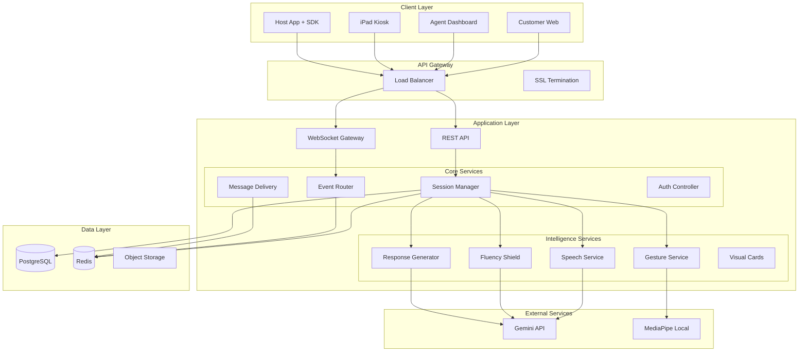
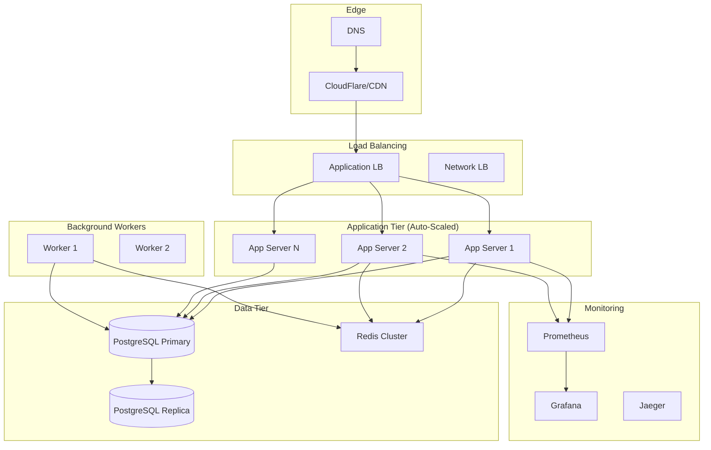
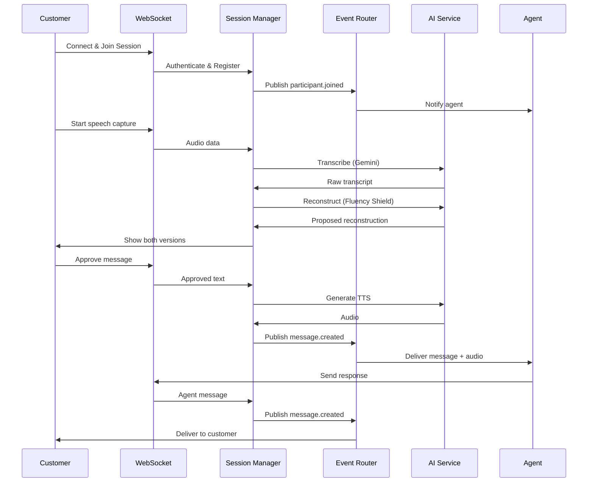

# InterACT — Technical Architecture Document

**Version:** 1.0  
**Last Updated:** November 20, 2026  
**Status:** Development Baseline

---

## Table of Contents
1. [System Overview](#system-overview)
2. [Technology Stack](#technology-stack)
3. [Architecture Diagrams](#architecture-diagrams)
4. [Component Specifications](#component-specifications)
5. [Data Models](#data-models)
6. [Infrastructure](#infrastructure)
7. [Security Architecture](#security-architecture)

---

## 1. System Overview

### 1.1 High-Level Architecture

```
┌─────────────────────────────────────────────────────────────┐
│                         CLIENTS                              │
├──────────────┬──────────────┬──────────────┬────────────────┤
│   Customer   │    Agent     │   iPad       │   External     │
│   Web App    │  Dashboard   │   Kiosk      │   Host App     │
│   (React)    │   (React)    │  (SwiftUI)   │   (via SDK)    │
└──────┬───────┴──────┬───────┴──────┬───────┴────────┬───────┘
       │              │              │                │
       └──────────────┴──────────────┴────────────────┘
                           │
                           ▼
              ┌────────────────────────┐
              │    API Gateway/LB      │
              │   (HTTPS/WSS)          │
              └────────────┬───────────┘
                           │
         ┌─────────────────┼─────────────────┐
         │                 │                 │
         ▼                 ▼                 ▼
┌────────────────┐  ┌─────────────┐  ┌──────────────┐
│   REST API     │  │  WebSocket  │  │  Static      │
│   (FastAPI)    │  │  Gateway    │  │  Assets/CDN  │
└────────┬───────┘  └──────┬──────┘  └──────────────┘
         │                 │
         └────────┬────────┘
                  │
         ┌────────▼───────────┐
         │  Core Services     │
         │  ┌──────────────┐  │
         │  │ Session      │  │
         │  │ Manager      │  │
         │  ├──────────────┤  │
         │  │ Event        │  │
         │  │ Router       │  │
         │  ├──────────────┤  │
         │  │ Message      │  │
         │  │ Delivery     │  │
         │  └──────────────┘  │
         └────────┬───────────┘
                  │
    ┌─────────────┼─────────────┐
    │             │             │
    ▼             ▼             ▼
┌─────────┐  ┌─────────┐  ┌──────────┐
│ Speech  │  │ Gesture │  │ Response │
│ Service │  │ Service │  │Generator │
└────┬────┘  └────┬────┘  └─────┬────┘
     │            │             │
     └────────────┼─────────────┘
                  │
    ┌─────────────┼─────────────┐
    │             │             │
    ▼             ▼             ▼
┌─────────┐  ┌─────────┐  ┌──────────┐
│ Gemini  │  │MediaPipe│  │PostgreSQL│
│   API   │  │  (Local)│  │  Redis   │
└─────────┘  └─────────┘  └──────────┘
```

### 1.2 System Principles

1. **Single Communication Engine**: All clients use same backend services
2. **Provider Independence**: AI services are swappable
3. **Local-First Privacy**: Process sensitive data locally when possible
4. **Event-Driven**: Async event system for real-time updates
5. **Horizontally Scalable**: Stateless services with shared state store
6. **Fail-Safe**: Graceful degradation on service failures

---

## 2. Technology Stack

### 2.1 Backend

```yaml
Runtime:
  - Python 3.11+
  - Node.js 20+ (for SDK build tools)

Framework:
  - FastAPI 0.104+
  - Pydantic v2 (validation)
  - SQLAlchemy 2.0 (ORM)

Real-Time:
  - WebSockets (native FastAPI)
  - Redis Pub/Sub (for multi-instance)

Database:
  - PostgreSQL 15+ (primary data store)
  - Redis 7+ (cache, sessions, pub/sub)

AI Integration:
  - Google Generative AI SDK
  - Gemini API (3.5 Transcribe, 3.8 Flash, 3.8 Flash-Lite TTS)

Media Processing:
  - FFmpeg (audio processing)
  - PIL/Pillow (image processing)

Background Tasks:
  - Celery (optional for heavy processing)
  - asyncio (for lightweight async tasks)
```

### 2.2 Frontend (Web)

```yaml
Framework:
  - React 18.2+
  - TypeScript 5.2+
  - Vite 5.0 (build tool)

State Management:
  - Zustand (lightweight) or Redux Toolkit

UI Components:
  - Tailwind CSS 3.3+
  - Radix UI (accessible primitives)
  - Framer Motion (animations)

Real-Time:
  - Native WebSocket
  - React Query (server state)

Media:
  - MediaPipe Hands (via @mediapipe/hands)
  - Web Audio API
  - MediaRecorder API

Testing:
  - Vitest (unit tests)
  - Playwright (e2e tests)
  - Testing Library (component tests)
```

### 2.3 iPad Kiosk

```yaml
Platform:
  - iOS 16+
  - SwiftUI
  - Swift 5.9+

Networking:
  - URLSession (REST)
  - Starscream (WebSocket)

Media:
  - AVFoundation (audio/video)
  - Vision Framework (hand detection)
  - Speech Framework (TTS)

Local Storage:
  - Core Data (if needed)
  - UserDefaults (settings)
  - Keychain (credentials)
```

### 2.4 SDK

```yaml
Package:
  - TypeScript 5.2+
  - ESM + CommonJS outputs
  - Tree-shakeable

Build:
  - tsup (bundler)
  - TypeDoc (documentation)

Testing:
  - Vitest
  - Mock Service Worker (MSW)
```

### 2.5 Infrastructure

```yaml
Hosting:
  - AWS/GCP/Azure (TBD based on budget)
  - Kubernetes (production) or Docker Compose (staging)

CI/CD:
  - GitHub Actions
  - Docker
  - Terraform (IaC)

Monitoring:
  - Prometheus (metrics)
  - Grafana (dashboards)
  - Loki (logs)
  - Jaeger (tracing)
  - Sentry (error tracking)

Load Balancing:
  - Nginx or AWS ALB
  - Sticky sessions for WebSocket
```

---

## 3. Architecture Diagrams

### 3.1 Component Diagram



### 3.2 Deployment Diagram



### 3.3 Data Flow Diagram



---

## 4. Component Specifications

### 4.1 Session Manager

**Responsibilities:**
- Create and manage session lifecycle
- Participant registration and authorization
- Session state management
- Cleanup and retention

**Key Methods:**
```python
class SessionManager:
    async def create_session(
        self,
        business_context: BusinessContext,
        config: SessionConfig
    ) -> Session
    
    async def join_session(
        self,
        session_id: str,
        participant: Participant
    ) -> JoinResult
    
    async def end_session(
        self,
        session_id: str,
        ended_by: str
    ) -> None
    
    async def get_session(
        self,
        session_id: str
    ) -> Optional[Session]
```

**State Management:**
- Store sessions in Redis with TTL
- Persist to PostgreSQL for audit
- Use Redis Pub/Sub for multi-instance coordination

### 4.2 Event Router

**Responsibilities:**
- Route events between participants
- Validate event schemas
- Ensure delivery guarantees
- Handle reconnections

**Event Types:**
```python
class EventType(str, Enum):
    # Session events
    SESSION_CREATED = "session.created"
    SESSION_JOINED = "session.joined"
    SESSION_ENDED = "session.ended"
    
    # Participant events
    PARTICIPANT_JOINED = "participant.joined"
    PARTICIPANT_LEFT = "participant.left"
    PARTICIPANT_ACTIVITY = "participant.activity"
    
    # Message events
    MESSAGE_CREATED = "message.created"
    MESSAGE_RECEIVED = "message.received"
    MESSAGE_FAILED = "message.failed"
    
    # Speech events
    SPEECH_TRANSCRIBED = "speech.transcribed"
    SPEECH_RECONSTRUCTED = "speech.reconstructed"
    SPEECH_APPROVED = "speech.approved"
    
    # Gesture events
    GESTURE_DETECTED = "gesture.detected"
    GESTURE_APPROVED = "gesture.approved"
    
    # Response events
    RESPONSES_GENERATED = "responses.generated"
    RESPONSE_SELECTED = "response.selected"
```

### 4.3 Speech Service

**Components:**
1. **Audio Capture Handler**
2. **Transcription Service** (Gemini 3.5 Transcribe)
3. **Fluency Shield** (reconstruction)
4. **TTS Service** (Gemini 3.8 Flash-Lite TTS)

**Flow:**
```python
class SpeechService:
    async def transcribe(
        self,
        audio: bytes,
        language: str = "auto"
    ) -> TranscriptionResult
    
    async def reconstruct(
        self,
        transcript: str,
        context: Optional[dict] = None
    ) -> ReconstructionResult
    
    async def generate_speech(
        self,
        text: str,
        language: str,
        voice: str = "default"
    ) -> AudioResult
```

### 4.4 Gesture Service

**Components:**
1. **Gesture Enrollment**
2. **Template Storage**
3. **Real-time Matching**
4. **Confidence Scoring**

**Architecture:**
- Client-side: MediaPipe landmark detection
- Send only: landmarks (not video frames)
- Server-side: Template matching and validation
- Storage: User-specific gesture templates in PostgreSQL

```python
class GestureService:
    async def enroll_gesture(
        self,
        user_id: str,
        gesture_name: str,
        phrase: str,
        samples: List[HandLandmarks]
    ) -> GestureTemplate
    
    async def match_gesture(
        self,
        user_id: str,
        landmarks: HandLandmarks
    ) -> Optional[GestureMatch]
    
    async def list_gestures(
        self,
        user_id: str
    ) -> List[GestureTemplate]
```

### 4.5 Response Generator

**Responsibilities:**
- Generate context-aware responses
- Validate grounding
- Ensure fact accuracy
- Provide diverse options

**Architecture:**
```python
class ResponseGenerator:
    async def generate_responses(
        self,
        context: BusinessContext,
        conversation_history: List[Message],
        latest_message: Message,
        language: str,
        count: int = 4
    ) -> ResponseOptions
    
    async def validate_grounding(
        self,
        response: str,
        context: BusinessContext
    ) -> GroundingValidation
```

---

## 5. Data Models

### 5.1 Core Models

```python
# Session Model
class Session(BaseModel):
    session_id: str
    organization_id: str
    business_context: BusinessContext
    status: SessionStatus  # active, ended, expired
    participants: List[Participant]
    created_at: datetime
    ended_at: Optional[datetime]
    config: SessionConfig

# Participant Model
class Participant(BaseModel):
    participant_id: str
    session_id: str
    role: ParticipantRole  # customer, agent
    joined_at: datetime
    left_at: Optional[datetime]
    connection_id: str  # WebSocket connection ID
    preferences: ParticipantPreferences

# Message Model
class Message(BaseModel):
    message_id: str
    session_id: str
    sender_id: str
    source: MessageSource  # text, speech, gesture, smart_chip
    content: MessageContent
    metadata: MessageMetadata
    created_at: datetime
    delivered_at: Optional[datetime]

# Business Context Model
class BusinessContext(BaseModel):
    context_type: str  # order, appointment, account
    context_id: str
    data: dict  # Flexible JSON structure
    updated_at: datetime
```

### 5.2 Event Models

```python
class Event(BaseModel):
    event_id: str
    schema_version: str = "1.0"
    session_id: str
    event_type: EventType
    timestamp: datetime
    sender: ParticipantInfo
    payload: dict
    
class ParticipantActivityEvent(Event):
    payload: ParticipantActivity
    
class ParticipantActivity(BaseModel):
    participant_id: str
    activity: ActivityType  # typing, recording, reviewing, idle
    timestamp: datetime
    expires_at: datetime
```

### 5.3 Speech Models

```python
class TranscriptionResult(BaseModel):
    transcript: str
    language: str
    confidence: float
    timestamps: Optional[List[WordTimestamp]]
    raw_response: dict

class ReconstructionResult(BaseModel):
    original: str
    reconstructed: str
    disfluencies: List[Disfluency]
    confidence: float
    preservation_score: float
    warnings: List[str]

class Disfluency(BaseModel):
    type: DisfluencyType  # repetition, filler, block
    span: Tuple[int, int]  # character positions
    text: str
```

### 5.4 Gesture Models

```python
class HandLandmarks(BaseModel):
    landmarks: List[Landmark]  # 21 points
    handedness: str  # left, right
    confidence: float

class Landmark(BaseModel):
    x: float
    y: float
    z: float

class GestureTemplate(BaseModel):
    gesture_id: str
    user_id: str
    name: str
    phrase: str
    samples: List[NormalizedLandmarks]
    created_at: datetime

class GestureMatch(BaseModel):
    gesture_id: str
    phrase: str
    confidence: float
    matched_at: datetime
```

---

## 6. Infrastructure

### 6.1 Environment Configuration

```yaml
# Development
services:
  - app (FastAPI)
  - postgres
  - redis
  - nginx (optional)

# Staging
services:
  - app (3 replicas)
  - postgres (primary + replica)
  - redis (cluster mode)
  - nginx/ALB
  - prometheus
  - grafana

# Production
services:
  - app (5+ replicas, auto-scaling)
  - postgres (primary + 2 replicas)
  - redis (cluster, 3+ nodes)
  - ALB + CloudFront/CDN
  - prometheus + thanos
  - grafana
  - jaeger
  - sentry
```

### 6.2 Scaling Strategy

**Horizontal Scaling:**
- Application servers: Stateless, scale to N instances
- Redis Pub/Sub: Coordinates WebSocket messages across instances
- PostgreSQL: Read replicas for queries
- Workers: Scale based on queue depth

**Vertical Scaling:**
- Database: Memory-optimized instances
- Redis: Network-optimized instances

**Auto-Scaling Rules:**
```yaml
triggers:
  - CPU > 70% for 2 minutes → scale up
  - CPU < 30% for 5 minutes → scale down
  - WebSocket connections > 80% capacity → scale up
  - Queue depth > 100 → add workers
  
limits:
  min_instances: 2
  max_instances: 20
  cooldown: 300 seconds
```

### 6.3 Database Schema Strategy

**PostgreSQL Tables:**
```sql
-- Core tables
sessions
participants
messages
events (audit log)

-- Intelligence tables
gesture_templates
gesture_samples
conversation_contexts

-- Configuration
organizations
workflows
settings

-- Monitoring
metrics_snapshots
error_logs
```

**Redis Data Structures:**
```
# Session state
session:{session_id} → hash (session data)
session:{session_id}:participants → set (participant IDs)

# Connection mapping
connection:{connection_id} → string (participant_id)
participant:{participant_id}:connection → string (connection_id)

# Pub/Sub channels
session:{session_id}:events → pubsub channel

# Activity tracking
activity:{participant_id} → string (activity state, TTL 60s)

# Rate limiting
ratelimit:{user_id}:{endpoint} → counter (TTL based)
```

---

## 7. Security Architecture

### 7.1 Authentication & Authorization

**Authentication:**
```python
# JWT-based authentication
class AuthService:
    def generate_token(
        self,
        user_id: str,
        role: str,
        session_id: Optional[str]
    ) -> str
    
    def verify_token(
        self,
        token: str
    ) -> TokenPayload
```

**Authorization Matrix:**
```yaml
Customer:
  can:
    - Join own sessions
    - Send messages in own sessions
    - View own session history
  cannot:
    - View other sessions
    - Access agent dashboard
    - Modify business context

Agent:
  can:
    - Join assigned sessions
    - View customer messages
    - Send messages and visual cards
    - End sessions
  cannot:
    - Access sessions outside organization
    - Modify session config
    - Access other agents' sessions

Admin:
  can:
    - View all organization sessions
    - Manage workflows
    - Configure settings
    - View analytics
  cannot:
    - Access other organizations
```

### 7.2 Data Privacy

**PII Protection:**
```python
# Automatic PII redaction in logs
class PIIRedactor:
    patterns = {
        "phone": r"\b\d{10}\b",
        "email": r"\b[A-Za-z0-9._%+-]+@[A-Za-z0-9.-]+\.[A-Z|a-z]{2,}\b",
        "card": r"\b\d{4}[\s-]?\d{4}[\s-]?\d{4}[\s-]?\d{4}\b"
    }
    
    def redact(self, text: str) -> str:
        # Redact PII patterns
        pass
```

**Retention Policies:**
```yaml
session_metadata: 90 days
messages: 30 days (configurable)
transcripts: 7 days (configurable)
audio: deleted immediately after TTS generation
video_frames: never stored (local processing only)
gestures: templates stored indefinitely, samples deleted after enrollment
```

### 7.3 Transport Security

```yaml
TLS:
  version: 1.3
  ciphers: 
    - TLS_AES_256_GCM_SHA384
    - TLS_AES_128_GCM_SHA256
  
CORS:
  allowed_origins:
    - https://app.interact.example.com
    - https://agent.interact.example.com
  allowed_methods: [GET, POST, PUT, DELETE, OPTIONS]
  allow_credentials: true

WebSocket:
  upgrade_insecure_requests: true
  origin_validation: strict
  heartbeat: 30 seconds
```

### 7.4 Rate Limiting

```yaml
Global:
  requests_per_minute: 100
  burst: 20

Session Creation:
  per_user: 10 per hour
  per_ip: 50 per hour

AI Services:
  transcription: 30 per minute per user
  tts: 30 per minute per user
  response_generation: 20 per minute per user

WebSocket:
  connections_per_user: 5
  messages_per_minute: 120
```

---

## 8. Error Handling Strategy

### 8.1 Error Categories

```python
class ErrorCategory(str, Enum):
    # Client errors (4xx)
    VALIDATION_ERROR = "validation_error"
    AUTHENTICATION_ERROR = "authentication_error"
    AUTHORIZATION_ERROR = "authorization_error"
    NOT_FOUND = "not_found"
    RATE_LIMIT = "rate_limit_exceeded"
    
    # Server errors (5xx)
    INTERNAL_ERROR = "internal_error"
    SERVICE_UNAVAILABLE = "service_unavailable"
    AI_SERVICE_ERROR = "ai_service_error"
    DATABASE_ERROR = "database_error"
    TIMEOUT = "timeout"

class ErrorResponse(BaseModel):
    error_id: str
    error_category: ErrorCategory
    message: str
    details: Optional[dict]
    retry_after: Optional[int]  # seconds
    support_reference: str
```

### 8.2 Fallback Strategies

```yaml
AI Service Failure:
  - Return cached response if available
  - Use simplified template response
  - Allow manual text entry
  - Display clear error message
  - Log for investigation

Database Connection Lost:
  - Use connection pool retry (3 attempts)
  - Fail over to replica
  - Return cached data if possible
  - Queue writes for retry
  - Alert operations

WebSocket Disconnect:
  - Client auto-reconnect with exponential backoff
  - Server maintains session for 5 minutes
  - Replay missed events on reconnect
  - Client shows connection status

TTS Generation Fails:
  - Deliver text without audio
  - Show visual indicator
  - Allow retry
  - Fallback to browser TTS (Web Speech API)
```

---

## 9. Performance Targets

```yaml
API Response Times:
  p50: < 100ms
  p95: < 300ms
  p99: < 1000ms

WebSocket Latency:
  message_delivery: < 100ms
  event_propagation: < 50ms

AI Service Times:
  transcription: < 3 seconds
  reconstruction: < 2 seconds
  response_generation: < 3 seconds
  tts_generation: < 2 seconds

Database Queries:
  simple_query: < 10ms
  complex_query: < 100ms
  write_operation: < 50ms

Gesture Recognition:
  landmark_detection: < 100ms (client)
  matching: < 50ms (server)
  end_to_end: < 200ms

Throughput:
  concurrent_sessions: 1,000+
  messages_per_second: 1,000+
  websocket_connections: 10,000+
```

---

## 10. Monitoring & Observability

### 10.1 Key Metrics

```yaml
Application Metrics:
  - request_rate (req/s)
  - error_rate (%)
  - response_time (p50, p95, p99)
  - active_sessions
  - websocket_connections
  - message_throughput

AI Service Metrics:
  - transcription_latency
  - tts_generation_latency
  - response_generation_latency
  - ai_error_rate
  - api_quota_usage

Business Metrics:
  - sessions_created
  - sessions_completed
  - average_session_duration
  - feature_usage (fluency_shield, gestures, smart_chips)
  - customer_satisfaction_score

Infrastructure Metrics:
  - cpu_usage
  - memory_usage
  - disk_usage
  - network_throughput
  - database_connections
  - redis_memory
```

### 10.2 Logging Standards

```python
# Structured logging format
{
    "timestamp": "2026-11-20T10:00:00.000Z",
    "level": "INFO",
    "service": "speech-service",
    "trace_id": "abc123",
    "span_id": "def456",
    "session_id": "sess_001",
    "participant_id": "part_001",
    "event": "transcription_completed",
    "duration_ms": 2345,
    "metadata": {
        "language": "en",
        "audio_duration_ms": 5000
    }
}
```

### 10.3 Alerting Rules

```yaml
Critical Alerts (PagerDuty):
  - error_rate > 5% for 2 minutes
  - api_response_time_p95 > 2000ms for 5 minutes
  - database_connection_failures > 10 per minute
  - service_down for 1 minute

Warning Alerts (Slack):
  - error_rate > 1% for 5 minutes
  - ai_service_latency_p95 > 5000ms for 5 minutes
  - websocket_disconnect_rate > 10% for 5 minutes
  - disk_usage > 80%

Info Alerts (Dashboard):
  - deployment_completed
  - auto_scaling_triggered
  - cache_hit_rate < 70%
```

---

## Appendix A: Technology Decision Matrix

| Requirement | Options Considered | Selected | Rationale |
|-------------|-------------------|----------|-----------|
| Backend Framework | FastAPI, Flask, Django | FastAPI | Async support, automatic OpenAPI, type hints |
| Database | PostgreSQL, MongoDB, MySQL | PostgreSQL | ACID compliance, JSON support, mature |
| Cache/Session | Redis, Memcached | Redis | Pub/Sub, persistence, data structures |
| Frontend | React, Vue, Svelte | React | Ecosystem, talent availability, maturity |
| Real-time | WebSocket, SSE, polling | WebSocket | Bidirectional, low latency, standard |
| AI Provider | Gemini, GPT-4, Claude | Gemini | Competition requirement, cost, features |
| State Management | Redux, Zustand, Jotai | Zustand | Simplicity, performance, no boilerplate |

---

## Appendix B: File Structure

```
interact/
├── backend/
│   ├── app/
│   │   ├── __init__.py
│   │   ├── main.py
│   │   ├── api/
│   │   │   ├── __init__.py
│   │   │   ├── sessions.py
│   │   │   ├── websocket.py
│   │   │   └── health.py
│   │   ├── core/
│   │   │   ├── __init__.py
│   │   │   ├── config.py
│   │   │   ├── security.py
│   │   │   └── logging.py
│   │   ├── services/
│   │   │   ├── session_manager.py
│   │   │   ├── event_router.py
│   │   │   ├── speech_service.py
│   │   │   ├── gesture_service.py
│   │   │   └── response_generator.py
│   │   ├── models/
│   │   │   ├── session.py
│   │   │   ├── participant.py
│   │   │   ├── message.py
│   │   │   └── events.py
│   │   └── utils/
│   │       ├── redis_client.py
│   │       └── db.py
│   ├── tests/
│   ├── requirements.txt
│   └── Dockerfile
├── frontend/
│   ├── src/
│   │   ├── App.tsx
│   │   ├── main.tsx
│   │   ├── features/
│   │   │   ├── customer/
│   │   │   ├── agent/
│   │   │   ├── fluency-shield/
│   │   │   └── gestures/
│   │   ├── services/
│   │   │   ├── api.ts
│   │   │   ├── websocket.ts
│   │   │   └── speech.ts
│   │   └── types/
│   ├── package.json
│   └── vite.config.ts
├── sdk/
│   ├── src/
│   │   ├── index.ts
│   │   ├── client.ts
│   │   ├── types.ts
│   │   └── events.ts
│   ├── package.json
│   └── tsconfig.json
├── ios-kiosk/
│   ├── InterACTKiosk/
│   │   ├── App/
│   │   ├── Features/
│   │   ├── Services/
│   │   └── Models/
│   └── InterACTKiosk.xcodeproj
├── infrastructure/
│   ├── terraform/
│   ├── kubernetes/
│   └── docker-compose.yml
└── docs/
    ├── api/
    ├── architecture/
    └── guides/
```

---

**Document Status:** Ready for Implementation  
**Next Steps:** Review and approve before development kickoff
