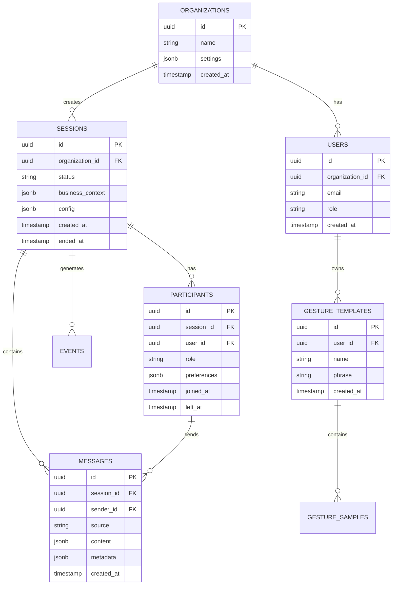

# InterACT — Database Schema

**Version:** 1.0  
**Database:** PostgreSQL 15+  
**Last Updated:** November 20, 2026

---

## Table of Contents
1. [Overview](#overview)
2. [Schema Diagrams](#schema-diagrams)
3. [Table Definitions](#table-definitions)
4. [Indexes](#indexes)
5. [Relationships](#relationships)
6. [Redis Schema](#redis-schema)
7. [Migration Strategy](#migration-strategy)

---

## 1. Overview

### 1.1 Database Strategy

**PostgreSQL (Primary Storage):**
- Sessions metadata
- Participants
- Messages (persistent)
- Gesture templates
- Configuration
- Audit logs

**Redis (Cache & Real-time):**
- Active session state
- WebSocket connection mapping
- Participant activity (TTL)
- Rate limiting
- Pub/Sub for events

### 1.2 Design Principles

1. **Normalization**: 3NF for most tables
2. **Denormalization**: Where read performance critical
3. **Soft Deletes**: Use `deleted_at` for audit trail
4. **Timestamps**: All tables have `created_at`, `updated_at`
5. **UUIDs**: For distributed ID generation
6. **JSON**: For flexible schema (business_context, metadata)

---

## 2. Schema Diagrams

### 2.1 Entity Relationship Diagram



---

## 3. Table Definitions

### 3.1 Core Tables

#### organizations

```sql
CREATE TABLE organizations (
    id UUID PRIMARY KEY DEFAULT gen_random_uuid(),
    name VARCHAR(255) NOT NULL,
    slug VARCHAR(100) UNIQUE NOT NULL,
    settings JSONB DEFAULT '{}',
    status VARCHAR(50) DEFAULT 'active',
    created_at TIMESTAMP WITH TIME ZONE DEFAULT NOW(),
    updated_at TIMESTAMP WITH TIME ZONE DEFAULT NOW(),
    deleted_at TIMESTAMP WITH TIME ZONE
);

CREATE INDEX idx_organizations_slug ON organizations(slug);
CREATE INDEX idx_organizations_status ON organizations(status) WHERE deleted_at IS NULL;

COMMENT ON TABLE organizations IS 'Organizations using InterACT platform';
COMMENT ON COLUMN organizations.settings IS 'Organization-specific configuration';
```

#### users

```sql
CREATE TABLE users (
    id UUID PRIMARY KEY DEFAULT gen_random_uuid(),
    organization_id UUID REFERENCES organizations(id),
    email VARCHAR(255) UNIQUE NOT NULL,
    password_hash VARCHAR(255),
    role VARCHAR(50) NOT NULL CHECK (role IN ('customer', 'agent', 'admin')),
    full_name VARCHAR(255),
    preferences JSONB DEFAULT '{}',
    status VARCHAR(50) DEFAULT 'active',
    last_login_at TIMESTAMP WITH TIME ZONE,
    created_at TIMESTAMP WITH TIME ZONE DEFAULT NOW(),
    updated_at TIMESTAMP WITH TIME ZONE DEFAULT NOW(),
    deleted_at TIMESTAMP WITH TIME ZONE
);

CREATE INDEX idx_users_email ON users(email) WHERE deleted_at IS NULL;
CREATE INDEX idx_users_organization ON users(organization_id) WHERE deleted_at IS NULL;
CREATE INDEX idx_users_role ON users(role);

COMMENT ON TABLE users IS 'Platform users (customers, agents, admins)';
```

#### sessions

```sql
CREATE TABLE sessions (
    id UUID PRIMARY KEY DEFAULT gen_random_uuid(),
    organization_id UUID REFERENCES organizations(id),
    session_id VARCHAR(100) UNIQUE NOT NULL,
    status VARCHAR(50) NOT NULL DEFAULT 'active' 
        CHECK (status IN ('active', 'ended', 'expired')),
    business_context JSONB NOT NULL,
    config JSONB DEFAULT '{}',
    created_at TIMESTAMP WITH TIME ZONE DEFAULT NOW(),
    updated_at TIMESTAMP WITH TIME ZONE DEFAULT NOW(),
    ended_at TIMESTAMP WITH TIME ZONE,
    expires_at TIMESTAMP WITH TIME ZONE NOT NULL,
    ended_by UUID REFERENCES users(id),
    end_reason VARCHAR(100)
);

CREATE INDEX idx_sessions_session_id ON sessions(session_id);
CREATE INDEX idx_sessions_organization ON sessions(organization_id);
CREATE INDEX idx_sessions_status ON sessions(status);
CREATE INDEX idx_sessions_created_at ON sessions(created_at DESC);
CREATE INDEX idx_sessions_business_context ON sessions USING GIN (business_context);

COMMENT ON TABLE sessions IS 'Communication sessions between customers and agents';
COMMENT ON COLUMN sessions.business_context IS 'Order, appointment, or account context';
```

#### participants

```sql
CREATE TABLE participants (
    id UUID PRIMARY KEY DEFAULT gen_random_uuid(),
    session_id UUID REFERENCES sessions(id) ON DELETE CASCADE,
    user_id UUID REFERENCES users(id),
    participant_id VARCHAR(100) NOT NULL,
    role VARCHAR(50) NOT NULL CHECK (role IN ('customer', 'agent')),
    preferences JSONB DEFAULT '{}',
    joined_at TIMESTAMP WITH TIME ZONE DEFAULT NOW(),
    left_at TIMESTAMP WITH TIME ZONE,
    
    UNIQUE(session_id, participant_id)
);

CREATE INDEX idx_participants_session ON participants(session_id);
CREATE INDEX idx_participants_user ON participants(user_id);
CREATE INDEX idx_participants_role ON participants(role);

COMMENT ON TABLE participants IS 'Session participants';
```

#### messages

```sql
CREATE TABLE messages (
    id UUID PRIMARY KEY DEFAULT gen_random_uuid(),
    session_id UUID REFERENCES sessions(id) ON DELETE CASCADE,
    sender_id UUID REFERENCES participants(id),
    message_id VARCHAR(100) UNIQUE NOT NULL,
    source VARCHAR(50) NOT NULL 
        CHECK (source IN ('text', 'speech', 'gesture', 'smart_chip')),
    content JSONB NOT NULL,
    metadata JSONB DEFAULT '{}',
    created_at TIMESTAMP WITH TIME ZONE DEFAULT NOW(),
    delivered_at TIMESTAMP WITH TIME ZONE,
    read_at TIMESTAMP WITH TIME ZONE,
    deleted_at TIMESTAMP WITH TIME ZONE
);

CREATE INDEX idx_messages_session ON messages(session_id, created_at DESC);
CREATE INDEX idx_messages_sender ON messages(sender_id);
CREATE INDEX idx_messages_message_id ON messages(message_id);
CREATE INDEX idx_messages_source ON messages(source);

COMMENT ON TABLE messages IS 'All messages exchanged in sessions';
COMMENT ON COLUMN messages.content IS 'Message text, audio URL, and metadata';
```

### 3.2 Speech & Intelligence Tables

#### speech_transcriptions

```sql
CREATE TABLE speech_transcriptions (
    id UUID PRIMARY KEY DEFAULT gen_random_uuid(),
    session_id UUID REFERENCES sessions(id) ON DELETE CASCADE,
    participant_id UUID REFERENCES participants(id),
    audio_url VARCHAR(500),
    transcript TEXT NOT NULL,
    language VARCHAR(10),
    confidence NUMERIC(3, 2),
    duration_seconds NUMERIC(8, 2),
    timestamps JSONB,
    provider VARCHAR(50),
    provider_response JSONB,
    created_at TIMESTAMP WITH TIME ZONE DEFAULT NOW()
);

CREATE INDEX idx_transcriptions_session ON speech_transcriptions(session_id);
CREATE INDEX idx_transcriptions_participant ON speech_transcriptions(participant_id);
CREATE INDEX idx_transcriptions_created_at ON speech_transcriptions(created_at DESC);

COMMENT ON TABLE speech_transcriptions IS 'Speech-to-text transcription results';
```

#### speech_reconstructions

```sql
CREATE TABLE speech_reconstructions (
    id UUID PRIMARY KEY DEFAULT gen_random_uuid(),
    transcription_id UUID REFERENCES speech_transcriptions(id),
    session_id UUID REFERENCES sessions(id) ON DELETE CASCADE,
    original_text TEXT NOT NULL,
    reconstructed_text TEXT NOT NULL,
    was_edited BOOLEAN DEFAULT FALSE,
    approved_text TEXT,
    disfluencies JSONB,
    confidence NUMERIC(3, 2),
    preservation_score NUMERIC(3, 2),
    warnings JSONB,
    approved_at TIMESTAMP WITH TIME ZONE,
    created_at TIMESTAMP WITH TIME ZONE DEFAULT NOW()
);

CREATE INDEX idx_reconstructions_transcription ON speech_reconstructions(transcription_id);
CREATE INDEX idx_reconstructions_session ON speech_reconstructions(session_id);

COMMENT ON TABLE speech_reconstructions IS 'Fluency Shield reconstruction results';
```

#### gesture_templates

```sql
CREATE TABLE gesture_templates (
    id UUID PRIMARY KEY DEFAULT gen_random_uuid(),
    user_id UUID REFERENCES users(id) ON DELETE CASCADE,
    gesture_id VARCHAR(100) UNIQUE NOT NULL,
    name VARCHAR(100) NOT NULL,
    phrase TEXT NOT NULL,
    is_preset BOOLEAN DEFAULT FALSE,
    samples_count INTEGER DEFAULT 0,
    created_at TIMESTAMP WITH TIME ZONE DEFAULT NOW(),
    updated_at TIMESTAMP WITH TIME ZONE DEFAULT NOW(),
    deleted_at TIMESTAMP WITH TIME ZONE,
    
    UNIQUE(user_id, name)
);

CREATE INDEX idx_gestures_user ON gesture_templates(user_id) WHERE deleted_at IS NULL;
CREATE INDEX idx_gestures_preset ON gesture_templates(is_preset) WHERE is_preset = TRUE;

COMMENT ON TABLE gesture_templates IS 'User-defined gesture templates';
```

#### gesture_samples

```sql
CREATE TABLE gesture_samples (
    id UUID PRIMARY KEY DEFAULT gen_random_uuid(),
    template_id UUID REFERENCES gesture_templates(id) ON DELETE CASCADE,
    landmarks JSONB NOT NULL,
    normalized_landmarks JSONB NOT NULL,
    handedness VARCHAR(10),
    confidence NUMERIC(3, 2),
    created_at TIMESTAMP WITH TIME ZONE DEFAULT NOW()
);

CREATE INDEX idx_gesture_samples_template ON gesture_samples(template_id);

COMMENT ON TABLE gesture_samples IS 'Individual gesture capture samples';
COMMENT ON COLUMN gesture_samples.normalized_landmarks IS 'Normalized for position-invariant matching';
```

#### gesture_matches

```sql
CREATE TABLE gesture_matches (
    id UUID PRIMARY KEY DEFAULT gen_random_uuid(),
    session_id UUID REFERENCES sessions(id) ON DELETE CASCADE,
    participant_id UUID REFERENCES participants(id),
    template_id UUID REFERENCES gesture_templates(id),
    confidence NUMERIC(3, 2),
    was_confirmed BOOLEAN,
    matched_at TIMESTAMP WITH TIME ZONE DEFAULT NOW()
);

CREATE INDEX idx_gesture_matches_session ON gesture_matches(session_id);
CREATE INDEX idx_gesture_matches_template ON gesture_matches(template_id);
CREATE INDEX idx_gesture_matches_matched_at ON gesture_matches(matched_at DESC);

COMMENT ON TABLE gesture_matches IS 'Log of gesture recognition events';
```

#### response_generations

```sql
CREATE TABLE response_generations (
    id UUID PRIMARY KEY DEFAULT gen_random_uuid(),
    session_id UUID REFERENCES sessions(id) ON DELETE CASCADE,
    participant_id UUID REFERENCES participants(id),
    context JSONB NOT NULL,
    prompt TEXT,
    responses JSONB NOT NULL,
    selected_response_id VARCHAR(100),
    model VARCHAR(100),
    generation_time_ms INTEGER,
    created_at TIMESTAMP WITH TIME ZONE DEFAULT NOW()
);

CREATE INDEX idx_responses_session ON response_generations(session_id);
CREATE INDEX idx_responses_created_at ON response_generations(created_at DESC);

COMMENT ON TABLE response_generations IS 'Smart Voice Chip generation log';
```

### 3.3 Configuration Tables

#### workflows

```sql
CREATE TABLE workflows (
    id UUID PRIMARY KEY DEFAULT gen_random_uuid(),
    organization_id UUID REFERENCES organizations(id),
    workflow_id VARCHAR(100) UNIQUE NOT NULL,
    name VARCHAR(255) NOT NULL,
    type VARCHAR(50) NOT NULL CHECK (type IN ('hospital', 'banking', 'delivery', 'custom')),
    config JSONB NOT NULL,
    is_active BOOLEAN DEFAULT TRUE,
    created_at TIMESTAMP WITH TIME ZONE DEFAULT NOW(),
    updated_at TIMESTAMP WITH TIME ZONE DEFAULT NOW()
);

CREATE INDEX idx_workflows_organization ON workflows(organization_id);
CREATE INDEX idx_workflows_type ON workflows(type);

COMMENT ON TABLE workflows IS 'Workflow definitions (hospital, banking, etc.)';
```

#### visual_card_templates

```sql
CREATE TABLE visual_card_templates (
    id UUID PRIMARY KEY DEFAULT gen_random_uuid(),
    organization_id UUID REFERENCES organizations(id),
    template_id VARCHAR(100) UNIQUE NOT NULL,
    name VARCHAR(255) NOT NULL,
    card_type VARCHAR(50) NOT NULL,
    schema JSONB NOT NULL,
    ui_config JSONB,
    created_at TIMESTAMP WITH TIME ZONE DEFAULT NOW(),
    updated_at TIMESTAMP WITH TIME ZONE DEFAULT NOW()
);

CREATE INDEX idx_card_templates_organization ON visual_card_templates(organization_id);
CREATE INDEX idx_card_templates_type ON visual_card_templates(card_type);

COMMENT ON TABLE visual_card_templates IS 'Visual card template definitions';
```

### 3.4 Audit & Monitoring Tables

#### events

```sql
CREATE TABLE events (
    id UUID PRIMARY KEY DEFAULT gen_random_uuid(),
    event_id VARCHAR(100) UNIQUE NOT NULL,
    session_id UUID REFERENCES sessions(id) ON DELETE CASCADE,
    event_type VARCHAR(100) NOT NULL,
    sender_id UUID REFERENCES participants(id),
    payload JSONB NOT NULL,
    created_at TIMESTAMP WITH TIME ZONE DEFAULT NOW()
);

CREATE INDEX idx_events_session ON events(session_id, created_at DESC);
CREATE INDEX idx_events_type ON events(event_type);
CREATE INDEX idx_events_created_at ON events(created_at DESC);

COMMENT ON TABLE events IS 'Audit log of all session events';
```

#### error_logs

```sql
CREATE TABLE error_logs (
    id UUID PRIMARY KEY DEFAULT gen_random_uuid(),
    error_id VARCHAR(100) UNIQUE NOT NULL,
    session_id UUID REFERENCES sessions(id) ON DELETE SET NULL,
    user_id UUID REFERENCES users(id) ON DELETE SET NULL,
    error_code VARCHAR(100),
    error_category VARCHAR(50),
    message TEXT,
    stack_trace TEXT,
    context JSONB,
    created_at TIMESTAMP WITH TIME ZONE DEFAULT NOW()
);

CREATE INDEX idx_error_logs_session ON error_logs(session_id);
CREATE INDEX idx_error_logs_code ON error_logs(error_code);
CREATE INDEX idx_error_logs_created_at ON error_logs(created_at DESC);

COMMENT ON TABLE error_logs IS 'Application error log';
```

#### metrics_snapshots

```sql
CREATE TABLE metrics_snapshots (
    id UUID PRIMARY KEY DEFAULT gen_random_uuid(),
    metric_name VARCHAR(100) NOT NULL,
    metric_value NUMERIC,
    dimensions JSONB,
    timestamp TIMESTAMP WITH TIME ZONE NOT NULL,
    created_at TIMESTAMP WITH TIME ZONE DEFAULT NOW()
);

CREATE INDEX idx_metrics_name_time ON metrics_snapshots(metric_name, timestamp DESC);
CREATE INDEX idx_metrics_timestamp ON metrics_snapshots(timestamp DESC);

COMMENT ON TABLE metrics_snapshots IS 'Time-series metrics for analytics';
```

---

## 4. Indexes

### 4.1 Performance Indexes

```sql
-- Composite indexes for common queries

-- Find active sessions for organization
CREATE INDEX idx_sessions_org_active 
ON sessions(organization_id, status) 
WHERE status = 'active';

-- Recent messages in session
CREATE INDEX idx_messages_session_recent 
ON messages(session_id, created_at DESC) 
WHERE deleted_at IS NULL;

-- Active participants in session
CREATE INDEX idx_participants_session_active 
ON participants(session_id) 
WHERE left_at IS NULL;

-- User's gestures
CREATE INDEX idx_gestures_user_active 
ON gesture_templates(user_id) 
WHERE deleted_at IS NULL;

-- Recent transcriptions
CREATE INDEX idx_transcriptions_recent 
ON speech_transcriptions(session_id, created_at DESC);
```

### 4.2 Full-Text Search

```sql
-- Full-text search on messages
CREATE INDEX idx_messages_content_fts 
ON messages USING GIN (to_tsvector('english', content->>'text'));

-- Search query example:
-- SELECT * FROM messages 
-- WHERE to_tsvector('english', content->>'text') @@ to_tsquery('english', 'refund & card');
```

### 4.3 Partial Indexes

```sql
-- Only index non-deleted records
CREATE INDEX idx_users_active 
ON users(email) 
WHERE deleted_at IS NULL;

CREATE INDEX idx_sessions_active 
ON sessions(session_id) 
WHERE status = 'active';
```

---

## 5. Relationships

### 5.1 Foreign Key Constraints

```sql
-- Cascade deletes for session-dependent data
ALTER TABLE participants 
    ADD CONSTRAINT fk_participants_session 
    FOREIGN KEY (session_id) 
    REFERENCES sessions(id) 
    ON DELETE CASCADE;

ALTER TABLE messages 
    ADD CONSTRAINT fk_messages_session 
    FOREIGN KEY (session_id) 
    REFERENCES sessions(id) 
    ON DELETE CASCADE;

-- Preserve user data even if session deleted
ALTER TABLE gesture_templates 
    ADD CONSTRAINT fk_gestures_user 
    FOREIGN KEY (user_id) 
    REFERENCES users(id) 
    ON DELETE CASCADE;
```

### 5.2 Constraints

```sql
-- Ensure session has at least one participant role
CREATE OR REPLACE FUNCTION check_session_has_customer()
RETURNS TRIGGER AS $$
BEGIN
    IF NOT EXISTS (
        SELECT 1 FROM participants 
        WHERE session_id = NEW.session_id 
        AND role = 'customer'
        AND left_at IS NULL
    ) THEN
        RAISE EXCEPTION 'Session must have at least one customer';
    END IF;
    RETURN NEW;
END;
$$ LANGUAGE plpgsql;

-- Business logic constraints
ALTER TABLE sessions 
    ADD CONSTRAINT check_expires_after_created 
    CHECK (expires_at > created_at);

ALTER TABLE participants 
    ADD CONSTRAINT check_left_after_joined 
    CHECK (left_at IS NULL OR left_at > joined_at);

ALTER TABLE speech_reconstructions 
    ADD CONSTRAINT check_confidence_range 
    CHECK (confidence >= 0 AND confidence <= 1);
```

---

## 6. Redis Schema

### 6.1 Data Structures

```redis
# Active session state
session:{session_id}
  Type: Hash
  TTL: Session timeout (30 minutes default)
  Fields:
    - status: "active" | "ended"
    - participant_count: integer
    - created_at: timestamp
    - last_activity: timestamp
    - config: JSON string

# Session participants set
session:{session_id}:participants
  Type: Set
  TTL: Same as session
  Members: participant_id strings

# WebSocket connection mapping
connection:{connection_id}
  Type: String
  TTL: Connection timeout (5 minutes)
  Value: participant_id

participant:{participant_id}:connection
  Type: String
  TTL: Connection timeout (5 minutes)
  Value: connection_id

# Participant activity state
activity:{participant_id}
  Type: Hash
  TTL: 60 seconds (auto-expire)
  Fields:
    - activity: "typing" | "recording" | "reviewing" | "idle"
    - timestamp: ISO timestamp
    - session_id: string

# Rate limiting
ratelimit:{user_id}:{endpoint}
  Type: String (counter)
  TTL: Window duration (e.g., 60 seconds)
  Value: request count

# Pub/Sub channels
session:{session_id}:events
  Type: Pub/Sub channel
  Purpose: Distribute events to all session participants

# Message delivery tracking
message:{message_id}:delivery
  Type: Hash
  TTL: 5 minutes
  Fields:
    - sent_at: timestamp
    - delivered_to: JSON array of participant_ids
    - failed_to: JSON array of participant_ids

# Gesture recognition cache (optional)
gesture:{user_id}:templates
  Type: Hash
  TTL: 1 hour
  Fields: gesture_id -> JSON template data

# AI response cache (optional)
response_cache:{context_hash}
  Type: String (JSON)
  TTL: 5 minutes
  Value: Cached response options
```

### 6.2 Redis Key Patterns

```
# Key naming convention
{entity}:{id}:{sub_entity}
{entity}:{id}:{property}

# Examples
session:sess_123:participants
participant:part_456:connection
activity:part_456
ratelimit:user_789:transcribe
message:msg_001:delivery
```

### 6.3 Redis Operations

```python
# Session state management
async def get_active_session(session_id: str) -> dict:
    return await redis.hgetall(f"session:{session_id}")

async def update_session_activity(session_id: str):
    await redis.hset(
        f"session:{session_id}",
        "last_activity",
        datetime.utcnow().isoformat()
    )

# Participant activity
async def set_activity(participant_id: str, activity: str):
    await redis.hset(
        f"activity:{participant_id}",
        mapping={
            "activity": activity,
            "timestamp": datetime.utcnow().isoformat()
        }
    )
    await redis.expire(f"activity:{participant_id}", 60)

# Rate limiting
async def check_rate_limit(user_id: str, endpoint: str, limit: int) -> bool:
    key = f"ratelimit:{user_id}:{endpoint}"
    count = await redis.incr(key)
    if count == 1:
        await redis.expire(key, 60)
    return count <= limit
```

---

## 7. Migration Strategy

### 7.1 Migration Tool

Using Alembic for database migrations:

```python
# alembic/versions/001_initial_schema.py

def upgrade():
    # Create organizations table
    op.create_table(
        'organizations',
        sa.Column('id', postgresql.UUID(), nullable=False),
        sa.Column('name', sa.String(255), nullable=False),
        sa.Column('slug', sa.String(100), nullable=False),
        # ... other columns
        sa.PrimaryKeyConstraint('id')
    )
    
    # Create indexes
    op.create_index('idx_organizations_slug', 'organizations', ['slug'])
    
    # ... other tables

def downgrade():
    op.drop_table('organizations')
    # ... other rollbacks
```

### 7.2 Migration Sequence

```bash
# Migrations in order
001_initial_schema.py          # Core tables
002_speech_tables.py           # Speech and transcription
003_gesture_tables.py          # Gesture recognition
004_audit_tables.py            # Events and logging
005_indexes.py                 # Performance indexes
006_constraints.py             # Business logic constraints
007_functions.py               # Stored procedures
```

### 7.3 Data Seeding

```sql
-- Seed preset gestures
INSERT INTO gesture_templates (gesture_id, user_id, name, phrase, is_preset)
VALUES
    ('preset_thumbs_up', NULL, 'thumbs_up', 'Yes, I confirm', TRUE),
    ('preset_thumbs_down', NULL, 'thumbs_down', 'No, I disagree', TRUE),
    ('preset_open_palm', NULL, 'open_palm', 'Please wait a moment', TRUE),
    ('preset_fist', NULL, 'fist', 'Please repeat that', TRUE),
    ('preset_v_sign', NULL, 'v_sign', 'Thank you', TRUE);

-- Seed demo organization
INSERT INTO organizations (id, name, slug, settings)
VALUES
    ('550e8400-e29b-41d4-a716-446655440000', 'Demo Organization', 'demo', '{}');
```

### 7.4 Backup Strategy

```bash
# Daily full backup
pg_dump -Fc interact_db > backup_$(date +%Y%m%d).dump

# Point-in-time recovery
# Enable WAL archiving in postgresql.conf
wal_level = replica
archive_mode = on
archive_command = 'cp %p /backup/wal/%f'

# Restore to point in time
pg_restore -d interact_db backup_20261120.dump
```

---

## Appendix A: Sample Queries

```sql
-- Get active sessions with participant count
SELECT 
    s.session_id,
    s.status,
    s.created_at,
    COUNT(p.id) as participant_count,
    jsonb_agg(jsonb_build_object(
        'participant_id', p.participant_id,
        'role', p.role
    )) as participants
FROM sessions s
LEFT JOIN participants p ON s.id = p.id AND p.left_at IS NULL
WHERE s.status = 'active'
GROUP BY s.id;

-- Get session message history with sender info
SELECT 
    m.message_id,
    m.source,
    m.content->>'text' as text,
    m.created_at,
    p.participant_id,
    p.role as sender_role,
    u.full_name as sender_name
FROM messages m
JOIN participants p ON m.sender_id = p.id
LEFT JOIN users u ON p.user_id = u.id
WHERE m.session_id = '...'
    AND m.deleted_at IS NULL
ORDER BY m.created_at DESC
LIMIT 50;

-- Get user's gesture templates with sample count
SELECT 
    gt.gesture_id,
    gt.name,
    gt.phrase,
    COUNT(gs.id) as sample_count,
    gt.created_at
FROM gesture_templates gt
LEFT JOIN gesture_samples gs ON gt.id = gs.template_id
WHERE gt.user_id = '...'
    AND gt.deleted_at IS NULL
GROUP BY gt.id;

-- Session analytics
SELECT 
    DATE_TRUNC('hour', s.created_at) as hour,
    COUNT(*) as session_count,
    AVG(EXTRACT(EPOCH FROM (s.ended_at - s.created_at))) as avg_duration_seconds,
    COUNT(*) FILTER (WHERE s.end_reason = 'resolved') as resolved_count
FROM sessions s
WHERE s.created_at >= NOW() - INTERVAL '24 hours'
    AND s.status = 'ended'
GROUP BY DATE_TRUNC('hour', s.created_at)
ORDER BY hour DESC;
```

## Appendix B: Performance Tuning

```sql
-- Connection pooling (pgbouncer config)
pool_mode = transaction
max_client_conn = 1000
default_pool_size = 25

-- PostgreSQL config optimization
shared_buffers = 4GB
effective_cache_size = 12GB
maintenance_work_mem = 1GB
checkpoint_completion_target = 0.9
wal_buffers = 16MB
default_statistics_target = 100
random_page_cost = 1.1
effective_io_concurrency = 200
work_mem = 20MB
min_wal_size = 1GB
max_wal_size = 4GB

-- Vacuum settings
autovacuum = on
autovacuum_max_workers = 4
autovacuum_naptime = 10s
```

---

**Document Status:** Ready for Implementation  
**Next Steps:** Run migrations in development environment
