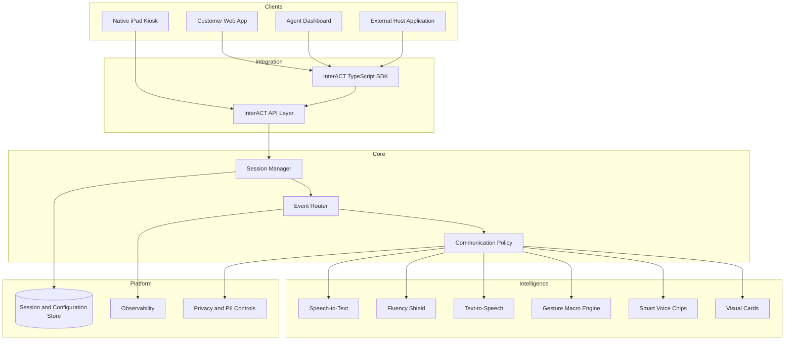

# InterACT — Product Requirements Document (PRD)

**Product:** InterACT  
**Document:** Product Requirements & Technical Implementation Specification  
**Version:** 1.0  
**Status:** Proposed implementation baseline  
**Product category:** Accessibility communication infrastructure  
**Primary deployment channels:** Digital SDK and physical iPad kiosk  
**Current sprint:** Multimodal accessibility communication platform  
**Deferred sprint:** Genuine Indian Sign Language (ISL) recognition and signing

---

# 1. Executive Summary

InterACT is a multimodal accessibility communication platform that enables people who are deaf, hard of hearing, non-speaking, or who experience speech disfluencies to communicate with businesses and institutions through accessible digital interfaces.

The platform provides a shared communication engine that supports multiple communication methods:

- Speech capture and transcription.
- Disfluency-aware speech reconstruction.
- Customer-approved speech output.
- Text-to-speech communication.
- Personalized gesture-to-phrase commands.
- Context-aware suggested responses.
- Visual communication cards.
- Real-time customer-agent communication.
- Communication-status indicators.
- Enterprise APIs and reusable SDK integration.
- Physical iPad kiosk workflows.

InterACT will initially demonstrate its digital deployment through a simulated food-delivery support application inspired by common customer-service workflows. It will also provide an iPad kiosk experience for hospital and banking workflows.

The product will use one shared communication engine across both deployment channels.

Genuine ISL recognition, ISL sentence translation, gloss generation, signing avatars and agent-to-customer signing are explicitly outside the current sprint.

## 1.1 Product vision

Make voice-centric services accessible through a unified communication layer that allows customers to communicate using the method that works best for them.

## 1.2 Product positioning

**InterACT — One accessibility engine. Multiple communication channels.**

InterACT is not simply a transcription application, a gesture-recognition application or a chatbot. It is a communication infrastructure layer that connects customers and service representatives through accessible interaction methods.

## 1.3 Product principles

1. Customer control: customers approve messages before they are communicated when approval is required.
2. Semantic preservation: accessibility processing must not change the intended meaning.
3. Multimodal communication: no customer should be forced to rely on a single communication method.
4. Shared infrastructure: kiosk and SDK deployments use the same communication engine.
5. Privacy by design: process sensitive data locally where feasible and minimize retention.
6. Honest capability representation: personalized gestures must never be represented as genuine ISL.
7. Enterprise compatibility: the integration layer should be reusable by external applications.
8. Observable engineering: latency, errors and network usage must be measured rather than fabricated.

---

# 2. Problem Statement

Most customer-service systems assume that customers can communicate through conventional spoken conversations.

This creates accessibility barriers in the following situations:

### 2.1 Non-speaking customers

A non-speaking customer may be unable to respond verbally to an agent. Typing an entire conversation can be slow and difficult, particularly during time-sensitive support interactions.

### 2.2 Customers who stammer or experience speech disfluencies

Speech repetitions, blocks and other disfluencies can make it difficult to communicate a message smoothly. Agents may interrupt or misunderstand the customer.

### 2.3 Deaf and hard-of-hearing customers

Customers may not be able to reliably understand audio instructions or participate in conventional voice-only support interactions.

### 2.4 Customers visiting physical institutions

Hospitals and banks often rely on spoken interactions at reception counters. Customers who cannot access those interactions need an alternative communication interface.

## 2.5 Product opportunity

InterACT provides a communication layer that makes these interactions accessible without requiring an organization to replace its entire customer-service infrastructure.

---

# 3. Goals and Non-Goals

## 3.1 Current sprint goals

The current sprint must deliver:

- A working customer-agent communication flow.
- A simulated business support experience.
- Type-to-voice communication.
- Real microphone-based speech capture.
- Speech transcription.
- Disfluency-aware message reconstruction.
- Customer review and approval.
- Text-to-speech output.
- Personalized gesture macros.
- Context-aware Smart Voice Chips.
- Agent voice input and visual responses.
- Anti-Hangup Shield.
- A reusable TypeScript SDK.
- Documented backend APIs and event contracts.
- A native iPad kiosk experience.
- Demonstration workflows for hospitals and banks.
- Privacy controls and observable system metrics.

## 3.2 Explicit non-goals

The following are not part of this sprint:

- Genuine ISL recognition.
- Validated temporal ISL model.
- Large-scale ISL vocabulary recognition.
- ISL sentence translation.
- Gloss sequence generation.
- ISL linguistic reconstruction.
- Agent-to-customer signing.
- Validated gloss-to-avatar animation.
- Production banking transaction execution.
- Actual medical-record access.
- Official Zomato integration.
- Actual PSTN or SIP telephony integration unless separately implemented and tested.
- Autonomous decisions on behalf of customers.

These capabilities belong to a subsequent ISL-focused sprint or a separately scoped enterprise integration project.

---

# 4. Target Users and Personas

## 4.1 Customer

A customer interacting with a business or institution who requires an accessible communication interface.

Potential communication methods:

- Text.
- Text-to-speech.
- Speech with transcription.
- Speech with disfluency assistance.
- Personalized gesture macros.
- Visual response cards.

The customer must be able to choose which features to enable.

## 4.2 Support agent

A customer-service employee who communicates with the customer.

The agent should be able to:

- Accept or join a session.
- Read incoming customer messages.
- Hear approved spoken messages.
- Speak normally.
- Send structured visual responses.
- See the customer's communication status.
- View relevant business context.
- End the session.

The agent should not need to learn a separate sign or gesture vocabulary to use the initial product.

## 4.3 Enterprise administrator

An organization configuring InterACT for its application or physical service environment.

The administrator should eventually be able to configure:

- Organization details.
- Service workflows.
- Supported languages.
- Staff accounts.
- Device access.
- Session policies.
- Communication features.
- Retention policies.

The current sprint may use controlled demo configuration rather than a complete enterprise administration console.

---

# 5. Product Architecture

## 5.1 Architectural principle

InterACT must have one shared accessibility engine with multiple clients.

The customer application, agent dashboard, SDK and iPad kiosk must not implement independent versions of session management, event routing or message processing.

## 5.2 Logical architecture

### Layer 1: Client applications

**Digital channel**
- Customer-facing demo application.
- Agent dashboard.
- External host application using the InterACT SDK.

**Physical channel**
- Native iPad kiosk.
- Staff-assisted interface where required.

### Layer 2: Shared communication engine

Responsibilities:

- Session creation.
- Session lifecycle.
- Customer-agent connection.
- Participant authorization.
- Message routing.
- Event validation.
- Reconnection handling.
- Communication status.
- Session cleanup.

### Layer 3: Accessibility intelligence services

Responsibilities:

- Speech capture.
- Speech transcription.
- Disfluency processing.
- Semantic preservation.
- Text-to-speech.
- Personalized gesture matching.
- Smart response generation.
- Structured visual responses.

Each intelligence service should be independently replaceable.

### Layer 4: Enterprise integration

Responsibilities:

- SDK initialization.
- Session APIs.
- Typed event contracts.
- Authentication.
- Configuration.
- Documentation.
- Host application integration.

### Layer 5: Privacy and observability

Responsibilities:

- Permission handling.
- Data minimization.
- PII protection.
- Audit events.
- Performance metrics.
- Error monitoring.
- Session retention policies.

## 5.3 Proposed architecture diagram



## 5.4 Existing infrastructure compatibility

The implementation should build on the existing InterACT Phase 1 and Phase 2 codebase.

The existing foundation includes the previously delivered FastAPI/WebSocket communication engine, session management, customer-agent connections and mock IVR functionality.

Before implementation, Antigravity must inspect the actual repository and determine:

- What code exists.
- What code is functional.
- What tests pass.
- Which endpoints are already implemented.
- Which event types already exist.
- Which components can be reused.
- Which features are only mocked.

Do not replace working components merely to match this document.

Do not assume that previously delivered functionality has passed acceptance testing until the relevant tests have been run.

---

# 6. Functional Requirements

Priority definitions:

- **P0:** Required for the current sprint's core demonstration.
- **P1:** Required for a complete implementation of the current sprint.
- **P2:** Enhancement that may be deferred without breaking the core demo.

## 6.1 Customer application

### FR-CUS-001: Accessible support entry

Priority: P0

The customer must be able to open the business application and select an accessible support option.

Acceptance criteria:

- An accessible support entry point is visible.
- The entry point opens the InterACT customer experience.
- The application displays the connection status.
- The customer can return to the previous screen when no session is active.

### FR-CUS-002: Session joining

Priority: P0

The customer must be able to join a session using a generated session identifier or an authorized session invitation.

Acceptance criteria:

- The backend creates a valid session.
- The customer can join the session.
- The customer receives connection confirmation.
- Invalid and expired sessions are rejected.
- Duplicate customer connections follow a defined policy.

### FR-CUS-003: Communication mode selection

Priority: P0

The customer must be able to choose the communication features they want to use.

Initial modes:

- Type to communicate.
- Speak with transcription.
- Speak with Fluency Shield.
- Personalized gesture commands.

Acceptance criteria:

- Mode selection is clear.
- Camera and microphone permissions are requested only when necessary.
- Customers can switch modes during an active session where supported.
- Permission denial does not prevent other communication methods from working.

### FR-CUS-004: Customer message history

Priority: P0

The customer must be able to see messages exchanged during the session.

Acceptance criteria:

- Messages appear in chronological order.
- Sender identity is displayed.
- Delivery state is displayed where available.
- Pending, delivered and failed states are visually distinguishable.
- Reconnection does not create duplicate visible messages.

---

# 7. Type-to-Voice Communication

## FR-TTV-001: Text composition

Priority: P0

The customer can enter a message using a text input.

Requirements:

- Support normal text input.
- Display the composed message before sending.
- Provide an explicit send action.
- Support editing before submission.
- Display message delivery status.

## FR-TTV-002: Text-to-speech generation

Priority: P0

The system converts an approved customer message into spoken audio.

Requirements:

- Support the configured language and voice.
- Allow the customer to hear a preview when supported.
- Generate speech only after the customer submits the message.
- Display TTS generation failures.
- Allow text delivery even if speech generation fails.

## FR-TTV-003: Agent delivery

Priority: P0

The approved text and generated speech must be made available to the agent.

The message payload must distinguish:

- Original text.
- Approved text.
- Language.
- Audio reference or audio stream, if generated.
- Timestamp.
- Message identifier.
- Delivery status.

The system must not send a draft as an approved message.

---

# 8. Fluency Shield

## 8.1 Feature objective

Fluency Shield assists customers who experience speech disfluencies by converting spoken input into a proposed clearer message while preserving the original meaning.

The customer must remain in control of the final message.

## FR-FS-001: Microphone capture

Priority: P0

The customer must be able to start and stop speech capture.

Requirements:

- Request microphone permission.
- Display microphone state.
- Show recording state clearly.
- Allow the customer to cancel capture.
- Handle permission denial.
- Handle microphone errors.
- Avoid recording when the customer has not activated capture.

## FR-FS-002: Speech transcription

Priority: P0

The captured audio must be transcribed into text.

Requirements:

- Preserve the raw transcription.
- Record the language when available.
- Associate the transcript with the active session.
- Display transcription errors.
- Do not silently discard an unsuccessful transcription.
- Support the initial configured languages.

The transcription provider must be configurable rather than permanently coupled to one provider.

## FR-FS-003: Disfluency-aware reconstruction

Priority: P0

The system must produce a proposed reconstruction of the customer's message.

It should identify and handle relevant disfluencies, such as:

- Repetitions.
- Filler words.
- Prolonged or repeated fragments when represented in the transcript.
- Interrupted phrases.
- Unclear speech segments.

The system must not assume every repetition is accidental. Repetition can carry meaning or emphasis.

Requirements:

- Preserve the original transcript.
- Produce a separate proposed transcript.
- Preserve named entities, numbers, amounts and dates.
- Preserve negation.
- Preserve questions and requests.
- Preserve uncertainty.
- Avoid inventing missing details.
- Return an ambiguity indicator when the intended meaning cannot be established confidently.

## FR-FS-004: Semantic preservation

Priority: P0

The reconstruction must preserve the intent of the customer's message.

Critical semantic elements include:

- Who is involved.
- What action is requested.
- Which object or service is involved.
- Relevant numbers and amounts.
- Dates and times.
- Negation.
- Conditions.
- Uncertainty.
- Urgency.

The reconstruction engine must not convert a question into an instruction, a refusal into consent, or an uncertain statement into a definite statement.

## FR-FS-005: Customer review and confirmation

Priority: P0

The customer must review the proposed message before it is delivered.

The interface must provide:

- Original transcript.
- Proposed reconstructed transcript.
- Edit option.
- Approve action.
- Reject or retry action.
- Cancel action.

Only the approved version may be sent to the agent as the customer's confirmed message.

If the customer edits the proposed message, the edited text becomes the approved version.

## FR-FS-006: Speech generation

Priority: P0

After approval, the system generates speech using TTS.

Requirements:

- Generate speech from approved text only.
- Display generation status.
- Deliver approved text even if audio generation fails.
- Associate audio with the correct message.
- Prevent duplicate speech delivery after reconnection.

## FR-FS-007: Fluency Shield safety behavior

Priority: P0

The system must:

- Never silently approve a reconstruction.
- Never claim that it understands unclear speech with certainty.
- Never fabricate a message to avoid a transcription failure.
- Preserve access to the original transcript.
- Allow the customer to cancel.
- Ask for clarification when required.
- Avoid automatically triggering financial, medical or account actions.

## FR-FS-008: Latency measurement

Priority: P1

Measure:

- Audio capture duration.
- Transcription processing duration.
- Reconstruction processing duration.
- Customer review duration.
- TTS generation duration.
- End-to-end processing duration.

Do not include customer review time in model processing latency.

---

# 9. Personalized Gesture Macros

## 9.1 Feature objective

Personalized Gesture Macros allow a customer to map recognizable hand poses to phrases or commands.

This is a configurable gesture-command system. It is not ISL translation.

## FR-GM-001: Camera permission

Priority: P0

The customer can activate gesture input.

Requirements:

- Request camera permission only when gesture mode is activated.
- Show camera activity clearly.
- Provide a camera-off action.
- Handle permission denial.
- Do not transmit raw camera frames through the communication event bus.

## FR-GM-002: Hand landmark detection

Priority: P0

The system uses MediaPipe hand landmark detection where supported.

Expected input:

- Up to 21 landmarks per detected hand.
- Three-dimensional landmark coordinates.
- Handedness information when available.
- Detection confidence.

The landmark-processing layer must be separated from the gesture-matching layer.

## FR-GM-003: Landmark normalization

Priority: P0

Normalize landmark coordinates to reduce sensitivity to hand position and scale.

Initial approach:

1. Translate coordinates relative to the wrist landmark.
2. Normalize by an appropriate hand-scale measurement.
3. Preserve useful relative hand geometry.
4. Handle missing or low-confidence landmarks.
5. Reject unusable detections.

The implementation must evaluate whether orientation normalization is necessary for the selected gesture set.

## FR-GM-004: Gesture enrollment

Priority: P0

The customer can create a custom gesture.

Enrollment flow:

1. Customer selects Create Gesture.
2. Customer enters a phrase.
3. Application displays a capture guide.
4. Customer records multiple examples.
5. The system extracts and normalizes landmarks.
6. The system creates a gesture template.
7. The customer tests the gesture.
8. The customer saves or retries.

The system should record multiple samples rather than relying on one frame or one pose.

## FR-GM-005: Gesture matching

Priority: P0

The system compares live hand landmarks against enrolled gesture templates.

Requirements:

- Similarity score.
- Configurable confidence threshold.
- Temporal stability check.
- Rejection of ambiguous detections.
- Minimum detection duration.
- Cooldown after a successful trigger.
- Feedback when a gesture is not recognized.

Cosine similarity may be evaluated as one matching method, but it must not be assumed to be sufficient for every gesture.

## FR-GM-006: Gesture-to-message conversion

Priority: P0

A recognized gesture resolves to a customer-configured phrase.

The phrase must be visible before it is communicated, unless the customer has explicitly enabled a safe, low-risk one-tap workflow.

Financial decisions, consent and account actions must always require explicit confirmation.

## FR-GM-007: Preset gestures

Priority: P1

Provide example configurable presets:

| Gesture label | Default phrase |
|---|---|
| Open palm | Please wait a moment |
| Thumbs up | Yes, I confirm |
| Thumbs down | No, I disagree |
| Pointing gesture | There is a missing item |
| Fist | Please repeat that |
| V-sign | Thank you |

Presets must be editable and removable.

They must not be represented as universal cultural meanings or ISL vocabulary.

## FR-GM-008: Local processing

Priority: P0

Where supported, camera frames and landmark extraction should remain on the customer device.

Only the recognized command or approved phrase should be sent to the backend.

The system must measure and report actual network behavior.

It may claim zero raw video transmission only after verifying that no raw frames are sent over the network.

---

# 10. Smart Voice Chips

## 10.1 Feature objective

Smart Voice Chips provide context-aware suggested responses that reduce the amount of typing required from the customer.

## FR-SVC-001: Business context

Priority: P0

The system must accept structured business context.

Example:

```json
{
  "order_id": "ZMT-4092",
  "items": ["Paneer Tikka"],
  "order_status": "delivered",
  "currency": "INR",
  "total_amount": 320
}
```

All demonstration data must be synthetic.

## FR-SVC-002: Agent utterance context

Priority: P0

The system must receive the agent's latest text message or speech transcription.

## FR-SVC-003: Suggested response generation

Priority: P0

The response engine generates a small number of relevant response suggestions.

Requirements:

- Use business context.
- Use the agent's latest message.
- Avoid inventing business facts.
- Generate concise options.
- Return structured response data.
- Handle model errors.
- Provide deterministic fallback responses.

## FR-SVC-004: Customer selection

Priority: P0

The customer selects a response.

The selected response is then:

1. Displayed to the customer.
2. Confirmed by the customer where necessary.
3. Converted to speech if TTS is enabled.
4. Sent to the agent.

The AI must never select and send a response without customer authorization.

## FR-SVC-005: Context boundaries

Priority: P0

The response generator must not:

- Invent a refund amount.
- Promise a delivery time.
- Confirm an order modification.
- Claim that a refund has been initiated.
- Make financial or medical decisions.

Suggested responses are communication assistance, not business-action execution.

---

# 11. Agent Dashboard

## FR-AG-001: Agent login or demo access

Priority: P0

The agent can access the agent dashboard.

The demo may use a controlled login mechanism, but the architecture should support organization-based authentication later.

## FR-AG-002: Incoming session

Priority: P0

The agent can see an incoming session and accept or join it.

Display:

- Session identifier.
- Connection status.
- Customer communication preferences.
- Relevant mock business context.
- Session creation time.

## FR-AG-003: Conversation interface

Priority: P0

The agent sees incoming and outgoing messages in chronological order.

Messages must identify their source:

- Typed customer message.
- Approved reconstructed speech.
- Gesture-generated phrase.
- Smart Voice Chip.
- Agent text.
- Agent speech transcription.
- System event.

## FR-AG-004: Agent voice input

Priority: P0

The agent can speak normally.

Requirements:

- Capture agent microphone audio.
- Transcribe speech.
- Display the transcription.
- Allow correction before sending when practical.
- Deliver the message to the customer.

The agent's microphone input must not be confused with customer Fluency Shield processing.

## FR-AG-005: Agent text input

Priority: P0

The agent can type and send text.

The message should be visible to the customer immediately after successful delivery.

## FR-AG-006: Visual response cards

Priority: P0

The agent can send structured visual cards.

Initial card types:

- Information.
- Confirmation request.
- Refund information.
- Appointment information.
- Queue information.
- Instructions.
- Resolution status.

A card must have a type, title, structured content and message identifier.

## FR-AG-007: Customer activity state

Priority: P0

The agent sees customer activity states:

- Idle.
- Typing.
- Recording.
- Transcribing.
- Reviewing message.
- Confirming message.
- Processing gesture.
- Sending.
- Disconnected.

The activity indicator should have a timestamp or expiration so stale states do not remain indefinitely.

## FR-AG-008: Session completion

Priority: P0

The agent can close the session.

The customer must receive a clear session-ended state.

The backend must clean up session resources according to the retention policy.

---

# 12. Anti-Hangup Shield

## FR-AH-001: Activity event

Priority: P0

The customer client publishes activity-state events when the customer is composing or preparing a response.

## FR-AH-002: Agent visibility

Priority: P0

The agent dashboard displays the current customer activity state.

## FR-AH-003: Stale state expiry

Priority: P0

Activity states must expire after a configurable period if no refresh is received.

## FR-AH-004: Hold messaging

Priority: P1

The interface may display a message such as:

"The customer is preparing a response. Please allow a moment."

This is an application-level status indicator.

It must not be represented as an audio signal injected into a real PSTN call unless that integration exists.

---

# 13. Zomato-Inspired Demonstration Application

## 13.1 Objective

Demonstrate the InterACT SDK and accessibility engine through a familiar customer-support scenario.

This is a simulated application. It must not imply an official Zomato partnership or access to real Zomato systems.

## FR-ZOM-001: Mock customer application

Priority: P0

Provide a food-delivery-style customer interface.

Required screens:

- Home or order list.
- Active order details.
- Order tracking.
- Accessible Support.
- InterACT communication screen.

## FR-ZOM-002: Synthetic order context

Priority: P0

Use synthetic order data.

Example:

- Order: ZMT-4092.
- Item: Paneer Tikka.
- Amount: ₹320.
- Status: Delivered.

The order context must be configurable and must not be hardcoded inside the intelligence service.

## FR-ZOM-003: Support session

Priority: P0

Customer can start a support session from the order screen.

## FR-ZOM-004: End-to-end demonstration

Priority: P0

A customer on one device and an agent on another device must be able to communicate.

The demo must show:

- Session creation.
- Customer joining.
- Agent joining.
- Customer text-to-voice.
- Smart Voice Chips.
- Personalized Gesture Macros.
- Fluency Shield.
- Agent speech or text.
- Visual cards.
- Customer activity status.

The demo must use real backend communication, not disconnected mock interfaces.

---

# 14. Reusable SDK and Enterprise APIs

## 14.1 SDK objective

Allow another application to integrate InterACT without copying the original demo application's business logic.

## FR-SDK-001: TypeScript package

Priority: P0

Create a reusable TypeScript package.

Proposed package name:

`@interact/accessibility-sdk`

The package should provide:

- Initialization.
- Configuration.
- Session management.
- Connection management.
- Typed event subscription.
- Message sending.
- Activity-state publishing.
- Visual-card support.
- Error handling.
- Cleanup.

The SDK must not directly own all UI components. It should expose stable communication primitives and optional reusable UI components if useful.

## FR-SDK-002: Initialization

Priority: P0

The host application can initialize the SDK using configuration.

Illustrative API:

```ts
const interact = new InterACT({
  baseUrl: "https://api.example.com",
  apiKey: "DEMO_KEY",
  applicationId: "food-support-demo"
});
```

This is an illustrative interface. Final API names must be reconciled with the existing backend and authentication model.

Production secret credentials must never be embedded in a public client bundle.

## FR-SDK-003: Session API

Priority: P0

The SDK must expose:

```ts
await interact.sessions.create(options);
await interact.sessions.join(sessionId, participant);
await interact.sessions.leave(sessionId);
await interact.sessions.end(sessionId);
```

The exact API contract must be documented and tested.

## FR-SDK-004: Event subscription

Priority: P0

The SDK must expose typed event subscription.

Illustrative usage:

```ts
interact.on("message.received", (message) => {
  // Update the host application.
});

interact.on("participant.activity", (activity) => {
  // Update activity indicators.
});

interact.on("connection.state", (state) => {
  // Update connection UI.
});
```

## FR-SDK-005: Sample integration

Priority: P0

Create a separate sample host application.

It must:

- Initialize the SDK.
- Create a session.
- Join as a customer.
- Join as an agent where applicable.
- Exchange messages.
- Receive session events.
- Handle disconnects.
- End a session.

The sample host must not import private components from the original demo application.

## FR-SDK-006: Documentation

Priority: P0

Documentation must include:

- Installation.
- Initialization.
- Authentication.
- Session creation.
- Session joining.
- Event subscriptions.
- Message sending.
- Error handling.
- Reconnection.
- Cleanup.
- Sample application.
- API reference.
- Security considerations.

## FR-SDK-007: API versioning

Priority: P1

Backend APIs and event schemas must be versioned.

Breaking changes must be documented.

---

# 15. iPad Kiosk Application

## 15.1 Product objective

Provide an accessible self-service communication interface for physical institutions.

The initial target is an 11-inch iPad in landscape orientation.

## FR-KIOSK-001: Native iPad application

Priority: P0

Build a native SwiftUI kiosk client.

The kiosk must communicate with the same InterACT backend and shared communication services used by the digital deployment.

Do not duplicate business logic inside the kiosk.

## FR-KIOSK-002: Welcome screen

Priority: P0

The kiosk displays:

- Organization branding.
- Welcome message.
- Language selection.
- Start assistance action.
- Accessibility options.
- Staff assistance action.

## FR-KIOSK-003: Language selection

Priority: P0

Allow the customer to choose a supported language.

The initial language set must be explicitly configured based on the available transcription, reconstruction and TTS capabilities.

Do not display a language as supported if its required speech capabilities have not been tested.

## FR-KIOSK-004: Communication mode

Priority: P0

The kiosk allows the customer to use:

- Text communication.
- Text-to-speech.
- Speech transcription.
- Fluency Shield.
- Personalized gesture commands, where supported.

## FR-KIOSK-005: Staff assistance

Priority: P0

The customer can request assistance from a staff member.

The request must be visible in the staff-facing workflow or demo dashboard.

## FR-KIOSK-006: Session reset

Priority: P0

After a session ends or times out:

- Clear visible customer content.
- Clear temporary audio buffers.
- Reset the customer-facing screen.
- Release camera and microphone resources.
- Return to the welcome screen.
- Preserve only records explicitly permitted by the retention policy.

## FR-KIOSK-007: Kiosk usability

Priority: P0

Requirements:

- Landscape-first layout.
- Large touch targets.
- Readable text.
- Clear contrast.
- Minimal navigation.
- Visible interaction feedback.
- No dependence on hover.
- Clear microphone and camera states.
- Accessible error messages.
- Recovery from network interruption.

---

# 16. Enterprise Workflows

## 16.1 Hospital workflow

Priority: P0

The initial hospital demo must support:

1. Hospital welcome screen.
2. Appointment assistance.
3. Registration guidance.
4. Department navigation.
5. Queue information.
6. Basic service questions.
7. Staff assistance request.

The demo should use synthetic patient and appointment information.

It must not access real patient records or initiate clinical decisions.

## 16.2 Banking workflow

Priority: P0

The initial banking demo must support:

1. Banking welcome screen.
2. Account-service navigation.
3. Card-blocking assistance guidance.
4. Transaction-support request.
5. Branch-service information.
6. Staff assistance request.

The demo should use synthetic accounts and transaction information.

It must not claim to block a real card or perform a real financial transaction.

Any real banking action requires explicit authorization and a separately implemented, tested enterprise integration.

## 16.3 Workflow configuration

Priority: P1

The architecture should allow organizations to configure:

- Workflow name.
- Welcome message.
- Available services.
- Supported languages.
- Visual-card templates.
- Staff escalation.
- Session timeout.
- Communication options.

---

# 17. Technical Requirements

## 17.1 Existing technology baseline

The existing project has used:

**Backend**
- Python.
- FastAPI.
- WebSockets.
- Session registry.
- Room management.

**Web frontend**
- React.
- Vite.
- TypeScript.

**iPad client**
- SwiftUI.

**Computer vision**
- MediaPipe hand landmarks.

**AI integration**
- Configurable speech-to-text provider.
- Configurable language-model provider.
- Configurable text-to-speech provider.

The implementation agent must inspect the actual repository before making changes. It must not assume these dependencies or versions are still identical.

## 17.2 Backend architecture

Recommended logical modules:

```text
backend/
  app/
    main.py

    api/
      sessions.py
      health.py
      workflows.py

    core/
      config.py
      security.py
      logging.py

    sessions/
      registry.py
      manager.py
      models.py

    communication/
      websocket.py
      router.py
      events.py
      delivery.py

    intelligence/
      speech/
        capture_contracts.py
        transcription.py
        reconstruction.py
        tts.py

      gestures/
        models.py
        matching.py
        enrollment.py

      smart_responses/
        generator.py
        schemas.py

      visual_cards/
        schemas.py
        service.py

    privacy/
      redaction.py
      retention.py

    observability/
      metrics.py
      tracing.py

    tests/
```

This is a proposed logical structure. Preserve the existing repository structure when it is already well organized.

## 17.3 Frontend architecture

Recommended logical structure:

```text
frontend/
  src/
    app/
    components/

    features/
      customer/
      agent/
      support/
      fluency-shield/
      gesture-macros/
      smart-voice-chips/
      visual-cards/
      session-status/
      sdk-demo/

    services/
      api/
      websocket/
      speech/
      camera/

    hooks/
    types/
    utils/
```

Components should not directly implement backend session logic.

Use a shared typed API/event layer.

## 17.4 SDK architecture

Recommended package structure:

```text
packages/
  interact-sdk/
    src/
      client/
      sessions/
      events/
      messages/
      activity/
      types/
      errors/
      index.ts

    tests/
    examples/
    README.md
    package.json
```

## 17.5 iPad architecture

Recommended SwiftUI structure:

```text
InterACTKiosk/
  App/
  Features/
    Welcome/
    LanguageSelection/
    WorkflowSelection/
    CustomerSession/
    Communication/
    FluencyShield/
    GestureMacros/
    VisualCards/
    StaffAssistance/
  Services/
    API/
    Session/
    Audio/
    Camera/
  Models/
  DesignSystem/
```

The iPad application must use the same API contracts as the digital clients.

---

# 18. Communication Protocol and Event Contracts

## 18.1 Event design principles

Every communication event should:

- Have a unique event identifier.
- Have a session identifier.
- Have a timestamp.
- Identify its sender.
- Include an event type.
- Include a schema version.
- Contain validated payload data.

Raw camera frames must never be sent through the general communication event bus.

Audio should be transported through a separately defined, permission-controlled path when required.

## 18.2 Initial event types

| Event | Purpose |
|---|---|
| `session.created` | Session created |
| `session.joined` | Participant joined |
| `session.ended` | Session ended |
| `participant.joined` | Participant joined room |
| `participant.left` | Participant left room |
| `connection.state` | Connection status |
| `message.created` | Message created |
| `message.received` | Message delivered to recipient |
| `message.failed` | Message delivery failed |
| `speech.capture.started` | Microphone capture started |
| `speech.capture.completed` | Capture completed |
| `speech.transcription.completed` | Transcription completed |
| `speech.reconstruction.proposed` | Reconstruction proposed |
| `speech.reconstruction.approved` | Customer approved reconstruction |
| `speech.reconstruction.rejected` | Customer rejected reconstruction |
| `speech.output.ready` | TTS output available |
| `gesture.detected` | Gesture recognized locally |
| `gesture.message.proposed` | Gesture phrase proposed |
| `gesture.message.approved` | Customer approved phrase |
| `smart.responses.generated` | Suggested responses generated |
| `participant.activity` | Customer activity updated |
| `visual.card.created` | Visual card sent |

The final event contract must be represented in shared TypeScript types and backend validation schemas.

## 18.3 Example message event

```json
{
  "schema_version": "1.0",
  "event_id": "evt_demo_001",
  "session_id": "session_demo_001",
  "type": "message.created",
  "timestamp": "2026-11-20T10:00:00Z",
  "sender": {
    "participant_id": "customer_001",
    "role": "customer"
  },
  "payload": {
    "message_id": "msg_001",
    "source": "fluency_shield",
    "original_text": "I I need to block my card",
    "approved_text": "I need to block my card",
    "language": "en",
    "approval_status": "approved"
  }
}
```

This is an illustrative contract. The final implementation must define required and optional fields, validation rules and event delivery behavior.

---

# 19. API Requirements

Initial API design:

| Method | Endpoint | Purpose |
|---|---|---|
| POST | `/api/v1/sessions` | Create session |
| GET | `/api/v1/sessions/{id}` | Get session |
| POST | `/api/v1/sessions/{id}/join` | Join session |
| POST | `/api/v1/sessions/{id}/leave` | Leave session |
| POST | `/api/v1/sessions/{id}/end` | End session |
| GET | `/api/v1/sessions/{id}/events` | Retrieve supported event history, if enabled |
| POST | `/api/v1/workflows` | Create/configure workflow |
| GET | `/api/v1/workflows/{id}` | Retrieve workflow |
| GET | `/health` | Health check |
| GET | `/ready` | Readiness check |

Real-time communication should use the existing WebSocket architecture where appropriate.

Illustrative WebSocket route:

```text
/ws/v1/sessions/{session_id}
```

The final endpoint structure must be reconciled with existing Phase 1 and Phase 2 code before implementation.

---

# 20. AI and Model Integration Requirements

## 20.1 Provider abstraction

Speech transcription, language reconstruction and TTS must be provider-independent.

Each service should expose an internal interface so that a provider can be replaced without rewriting the session engine.

## 20.2 Speech-to-text

Requirements:

- Configurable provider.
- Supported-language configuration.
- Error and timeout handling.
- Transcript timestamps where supported.
- Explicit distinction between raw transcript and corrected transcript.

## 20.3 Reconstruction model

The reconstruction prompt and processing logic must prioritize semantic preservation.

The model must receive only the information required for reconstruction.

It should return structured output, including:

- Original transcript.
- Proposed reconstruction.
- Detected disfluency types, when available.
- Ambiguity indicator.
- Explanation or uncertainty note.
- Preservation warnings.

The system must not assume that a language model can perfectly reconstruct unclear speech.

## 20.4 Text-to-speech

Requirements:

- Configurable provider.
- Configurable voice.
- Supported-language validation.
- Audio generation errors.
- Playback state.
- Message-to-audio association.

## 20.5 Smart response generation

The generator must use structured business context and the agent's latest utterance.

It must return constrained response options rather than arbitrary unstructured actions.

## 20.6 Model failure behavior

If an AI provider is unavailable:

- Display a clear error.
- Preserve the original text.
- Allow manual text communication.
- Do not fabricate a response.
- Do not silently substitute a different meaning.
- Allow retry when appropriate.

---

# 21. Privacy, Security and Data Governance

## 21.1 Core privacy principles

- Use synthetic data for demos.
- Request microphone and camera permission only when needed.
- Process camera frames locally where supported.
- Never send raw camera frames through the general event bus.
- Avoid persistent storage of raw audio unless explicitly required and consented to.
- Minimize stored transcripts.
- Restrict session access.
- Validate all client events on the backend.
- Use encrypted transport in deployed environments.
- Separate customer and agent permissions.

## 21.2 PII handling

Potential sensitive data includes:

- Names.
- Phone numbers.
- Account identifiers.
- Order identifiers.
- Financial information.
- Health-related information.

The platform must avoid placing sensitive information in logs.

Redaction must be implemented and tested before claims of PII-safe operation are made.

## 21.3 Session retention

Define configurable retention behavior for:

- Session metadata.
- Message text.
- Transcripts.
- Generated audio.
- Activity events.
- Audit events.

Temporary audio buffers should be released when no longer required.

The kiosk must reset after a session.

## 21.4 Authentication and authorization

The system must distinguish:

- Customer.
- Agent.
- Administrator.
- Device or kiosk.

A participant must only access sessions for which they are authorized.

Public client applications must not contain privileged server credentials.

---

# 22. Observability and SDK X-Ray

The demonstration should expose real system activity.

## 22.1 Metrics

Track where applicable:

- Session creation time.
- WebSocket connection time.
- Reconnection count.
- Message delivery latency.
- Speech transcription duration.
- Reconstruction duration.
- TTS generation duration.
- Gesture detection confidence.
- Smart response generation duration.
- Payload size.
- Errors by service.
- Session duration.

## 22.2 SDK X-Ray panel

The demo should include a technical inspection panel showing:

- Current session ID.
- Connected participants.
- Connection status.
- Recent events.
- Event timestamps.
- Processing durations.
- Actual payload sizes.
- Service errors.
- AI provider response status.

Do not fabricate latency numbers, bandwidth savings, recognition accuracy or network payload sizes.

If a metric is unavailable, display "Not measured" rather than a made-up value.

---

# 23. User Experience and Design Requirements

## 23.1 Visual design

The interface should communicate accessibility and trust.

Design principles:

- Clean and modern.
- Minimal visual clutter.
- Strong text hierarchy.
- High contrast.
- Large touch targets.
- Clear status indicators.
- Consistent component language.
- Clear distinction between draft and approved messages.

## 23.2 Customer interface

Prioritize:

- Communication mode selection.
- Message composition.
- Speech capture state.
- Reconstruction review.
- Gesture feedback.
- Smart response selection.
- Visual responses.
- Connection status.

## 23.3 Agent interface

Prioritize:

- Incoming session.
- Conversation history.
- Customer activity.
- Message source.
- Business context.
- Speech and text controls.
- Visual response composer.
- Session controls.

## 23.4 Kiosk interface

Prioritize:

- Simple welcome experience.
- Language selection.
- Clear next actions.
- Large touch controls.
- Minimal navigation.
- Privacy-aware session reset.

---

# 24. Performance and Reliability Requirements

The product should establish measurable baselines before optimizing.

Initial engineering requirements:

- WebSocket disconnects must be recoverable where possible.
- Duplicate messages must be prevented or identified.
- Failed AI requests must not block manual communication.
- The customer must always have a non-AI text fallback.
- Camera processing must not block the primary UI thread.
- Audio and camera resources must be released after use.
- Long-running sessions must handle stale connections.
- Kiosk sessions must reset reliably.
- Service failures must be observable.

Performance targets should be established after baseline testing on the actual target devices and networks.

Do not promise fixed sub-second speech processing or gesture-recognition latency without measurement.

---

# 25. Testing Strategy

## 25.1 Backend testing

Test:

- Session creation.
- Session joining.
- Participant authorization.
- Message routing.
- Duplicate event handling.
- Reconnection.
- Session expiration.
- Event validation.
- Error handling.
- Session cleanup.

## 25.2 Frontend testing

Test:

- Customer session joining.
- Agent session joining.
- Text communication.
- Text-to-speech.
- Microphone permission.
- Speech capture.
- Transcription.
- Reconstruction review.
- Customer approval.
- Gesture enrollment.
- Gesture matching.
- Smart Voice Chips.
- Visual cards.
- Activity status.
- Disconnection and recovery.

## 25.3 Fluency Shield evaluation

Create a controlled test set containing:

- Repeated words.
- Repeated phrases.
- Filler words.
- Interrupted sentences.
- Ambiguous speech.
- Negation.
- Numbers and amounts.
- Names.
- Dates and times.
- Questions.
- Requests.

Measure:

- Transcription accuracy.
- Semantic preservation.
- Critical information preservation.
- Incorrect reconstruction rate.
- Customer correction rate.
- Processing latency.

Do not evaluate reconstruction quality using readability alone.

## 25.4 Gesture testing

Test:

- Different hand sizes.
- Different camera distances.
- Different lighting.
- Different backgrounds.
- Hand rotation.
- Partial occlusion.
- Multiple hands.
- Similar-looking poses.
- Accidental gestures.
- Gesture transitions.
- Camera permission denial.

Measure:

- Precision.
- Recall.
- False activation rate.
- Rejection rate.
- Recognition latency.

A false gesture trigger can send an unintended message. Conservative rejection is preferable to unreliable automatic activation.

## 25.5 SDK testing

Test the SDK in a separate host application.

Verify:

- Installation.
- Initialization.
- Authentication.
- Session creation.
- Session joining.
- Event subscriptions.
- Message delivery.
- Reconnection.
- Error handling.
- Cleanup.

## 25.6 Kiosk testing

Test on the target iPad:

- Landscape layout.
- Touch target usability.
- Microphone permission.
- Camera permission.
- Network interruption.
- Session reset.
- Resource release.
- Staff assistance.
- Long-duration operation.

## 25.7 End-to-end testing

The primary acceptance test must use two separate devices:

Device A: Customer application.

Device B: Agent dashboard.

A third device may be used for the kiosk test.

The customer and agent must exchange messages through the real backend.

---

# 26. Sprint Delivery Plan

The following sequence is a recommended implementation order, not a claim that all features already exist.

## Sprint Stage 0 — Repository audit and architecture validation

Deliverables:

- Inspect existing repository.
- Inspect Phase 1 and Phase 2 implementations.
- Run existing tests.
- Document existing endpoints.
- Document event schemas.
- Identify incomplete and mocked features.
- Produce an implementation plan.

Exit criteria:

- Existing functionality is understood.
- No duplicate backend is introduced.
- Architecture changes are approved before major refactoring.

## Sprint Stage 1 — Shared event and communication foundation

Deliverables:

- Typed event contracts.
- Message metadata.
- Delivery status.
- Activity events.
- Session lifecycle integration.

Exit criteria:

- Customer and agent exchange typed events.
- Event validation works.
- Reconnection does not create duplicate messages.

## Sprint Stage 2 — Type-to-Voice and agent communication

Deliverables:

- Customer text composer.
- TTS integration.
- Agent message display.
- Agent speech input.
- Customer response display.

Exit criteria:

- Customer text can be spoken to the agent.
- Agent text or speech transcription reaches the customer.

## Sprint Stage 3 — Fluency Shield

Deliverables:

- Microphone capture.
- Speech transcription.
- Reconstruction service.
- Original and proposed transcript interface.
- Customer approval and editing.
- Approved TTS output.

Exit criteria:

- Customer can speak.
- Original transcription is retained.
- Proposed reconstruction is displayed.
- Customer can edit or reject.
- Only approved text is delivered.

## Sprint Stage 4 — Personalized Gesture Macros

Deliverables:

- MediaPipe integration.
- Landmark normalization.
- Gesture enrollment.
- Multiple-sample templates.
- Gesture matching.
- Confidence and stability controls.
- Phrase confirmation.

Exit criteria:

- Customer can enroll a gesture.
- The gesture can be recognized under tested conditions.
- An ambiguous gesture is rejected.
- Raw camera frames are not transmitted through the event bus.

## Sprint Stage 5 — Smart Voice Chips and visual communication

Deliverables:

- Synthetic order context.
- Context-aware suggestions.
- Customer selection.
- Visual card schema.
- Agent visual-card composer.
- Customer card renderer.

Exit criteria:

- Suggestions reflect the available context.
- Customer controls which response is sent.
- Visual cards render correctly on the customer device.

## Sprint Stage 6 — Zomato-inspired end-to-end demo

Deliverables:

- Mock order interface.
- Accessible Support entry.
- Customer and agent flow.
- Anti-Hangup Shield.
- SDK X-Ray.
- Two-device demo.

Exit criteria:

- Complete interaction works through the backend.
- No critical feature depends on a disconnected mock UI.

## Sprint Stage 7 — Reusable SDK

Deliverables:

- TypeScript package.
- Session API.
- Event subscriptions.
- Typed models.
- Error handling.
- Documentation.
- Separate sample host application.

Exit criteria:

- Separate application integrates the SDK.
- It can establish a session and exchange messages without copying demo application logic.

## Sprint Stage 8 — iPad kiosk

Deliverables:

- Native SwiftUI application.
- Welcome screen.
- Language selection.
- Communication mode.
- Staff assistance.
- Hospital workflow.
- Banking workflow.
- Session reset.

Exit criteria:

- The kiosk communicates through the shared backend.
- Session cleanup works.
- The application has been tested on the target iPad.

## Sprint Stage 9 — Security, reliability and release validation

Deliverables:

- Permission review.
- Privacy controls.
- Retention behavior.
- Error handling.
- Performance metrics.
- Regression tests.
- Deployment documentation.

Exit criteria:

- No critical privacy or session-isolation defects.
- Core workflows pass end-to-end testing.
- All reported performance metrics are measured.

---

# 27. Current Sprint Acceptance Criteria

The sprint is complete only when the following conditions are met.

## Customer experience

- [ ] Customer can start an accessible support session.
- [ ] Customer can communicate through text.
- [ ] Customer can generate speech from text.
- [ ] Customer can use speech capture.
- [ ] Customer can review a transcript.
- [ ] Customer can review a proposed reconstruction.
- [ ] Customer can approve, edit or reject the reconstruction.
- [ ] Approved speech reaches the agent.
- [ ] Customer can enroll a personalized gesture.
- [ ] Customer can use a recognized gesture to propose a phrase.
- [ ] Customer can select a Smart Voice Chip.
- [ ] Customer can receive visual response cards.

## Agent experience

- [ ] Agent can join a customer session.
- [ ] Agent can read customer messages.
- [ ] Agent can speak or send text.
- [ ] Agent can send visual response cards.
- [ ] Agent can see customer activity status.
- [ ] Agent can close the session.

## Digital SDK

- [ ] TypeScript SDK package exists.
- [ ] Public interfaces are documented.
- [ ] API and event contracts are documented.
- [ ] Separate sample host application works.
- [ ] Session and message flows pass integration tests.

## Kiosk

- [ ] Native iPad kiosk application exists.
- [ ] Landscape interface works.
- [ ] Welcome and language screens work.
- [ ] Communication modes are available.
- [ ] Hospital workflow works with synthetic data.
- [ ] Banking workflow works with synthetic data.
- [ ] Staff assistance flow works.
- [ ] Session reset works.

## Reliability and privacy

- [ ] Microphone permission is explicit.
- [ ] Camera permission is explicit.
- [ ] Raw camera frames do not enter the general event bus.
- [ ] Original speech transcript is preserved.
- [ ] Reconstruction requires customer approval.
- [ ] Session authorization is validated.
- [ ] Metrics reflect real measurements.
- [ ] Critical failures have usable fallbacks.

---

# 28. Deferred Sprint — Genuine ISL

This is explicitly a separate development scope.

## Deferred capabilities

1. Validated temporal ISL recognition.
2. Validated ISL vocabulary.
3. Signer-diverse dataset evaluation.
4. ISL sentence translation.
5. Gloss sequence generation.
6. Linguistic reconstruction.
7. Agent-to-customer signing.
8. Gloss-to-avatar mapping.
9. Validated avatar animation.
10. End-to-end bidirectional ISL communication.

The next sprint must include:

- Dataset and licensing audit.
- Model and preprocessing validation.
- Signer-independent evaluation.
- Vocabulary definition.
- Unknown-sign handling.
- Translation quality evaluation.
- Gloss linguistic validation.
- Avatar output validation.

Personalized Gesture Macros from the current sprint must remain technically and visually separate from this future ISL pipeline.

---

# 29. Risks and Mitigations

| Risk | Mitigation |
|---|---|
| Incorrect speech reconstruction | Preserve original transcript and require customer approval |
| Semantic changes | Validate negation, numbers, entities and intent |
| False gesture activation | Conservative thresholds, temporal stability and confirmation |
| AI provider outage | Manual text fallback |
| Network disconnection | Reconnection and message delivery state |
| Privacy leakage | Local processing, data minimization and retention controls |
| SDK tightly coupled to demo | Separate host application acceptance test |
| Kiosk session data exposure | Automatic reset and session cleanup |
| Misrepresentation of ISL | Explicitly label gestures as personalized commands |
| Fake performance metrics | Measure actual processing and payload sizes |
| Scope expansion | Keep genuine ISL outside the current sprint |

---

# 30. Product Success Metrics

The current sprint should measure product behavior rather than relying on vanity metrics.

## Communication success

- Percentage of sessions successfully established.
- Percentage of messages successfully delivered.
- Percentage of sessions completed without a critical error.

## Fluency Shield

- Transcription quality.
- Semantic preservation.
- Critical information preservation.
- Reconstruction rejection rate.
- Customer edit rate.
- Processing latency.

## Gesture Macros

- Gesture precision.
- Gesture recall.
- False activation rate.
- Enrollment completion rate.
- Recognition latency.

## Smart Voice Chips

- Suggestion relevance.
- Customer selection rate.
- Suggestion rejection rate.
- Invalid or unsupported suggestion rate.

## SDK

- Successful independent host integrations.
- Session creation success.
- Message delivery success.
- Documentation completeness.

## Kiosk

- Successful session completion.
- Workflow completion.
- Session reset reliability.
- Permission and connection failure recovery.

Do not set arbitrary accuracy or latency claims before baseline measurements are available.

---

# 31. Final Product Definition

At the end of the current sprint, InterACT should be a functional multimodal accessibility communication platform with:

1. A shared backend communication engine.
2. A customer-facing digital application.
3. An agent-facing support dashboard.
4. A Fluency Shield speech-assistance workflow.
5. Personalized Gesture Macros.
6. Context-aware Smart Voice Chips.
7. Structured visual communication.
8. Anti-Hangup Shield.
9. A reusable TypeScript SDK.
10. Documented APIs and integration examples.
11. A native iPad kiosk.
12. Hospital and banking demo workflows.
13. Measured observability and privacy controls.

Genuine ISL recognition, sentence translation and signing-avatar output are deferred to the next sprint.

**The final product principle: InterACT makes existing voice-centric services accessible by adding a shared, multimodal communication layer between the customer and the organization.**